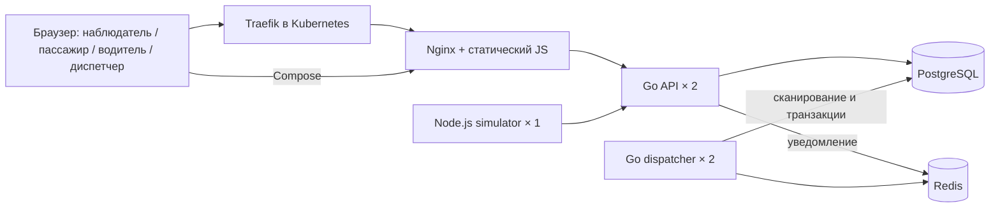
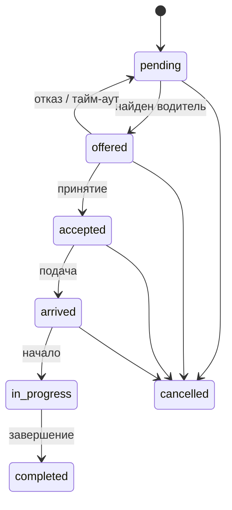

# Архитектура и инварианты

## Решения
Два Go-процесса используют общую библиотеку хранения, но разную роль запуска. Это разделяет HTTP и фоновые вычисления без дублирования схемы. Frontend написан на модульном JavaScript без фреймворка: объём интерфейса ограничен одним экраном, отдельная сборочная цепочка не нужна. Node.js обслуживает симуляцию: последовательный асинхронный цикл не запускает параллельно два tick одного процесса. Единственная реплика simulator разворачивается стратегией Recreate.

PostgreSQL — источник истины. Redis List не хранит бизнес-заказы, это ограниченная очередь сигналов «проверь БД». Сигнал можно потерять без потери заказа. Уведомление отправляется после SQL commit. Если процесс завершится между commit и LPUSH, работа обнаружится периодическим сканированием. Такая модель проще transactional outbox для учебного стенда. Цена — дополнительное сканирование и задержка обнаружения до следующего цикла. Называть её exactly-once delivery нельзя.

## Назначение
В одной короткой транзакции dispatcher берёт advisory lock координатора. Второй экземпляр при занятом lock пропускает цикл, сохраняя готовность подхватить работу после остановки первого. Это активные резервирующие обработчики с сериализацией критического участка, а не линейное ускорение от числа реплик.

Сначала истёкшие предложения возвращаются в pending, водители освобождаются. Затем выбирается самый старый заказ, для которого сейчас есть кандидат. Водитель должен быть available, соответствовать классу и не иметь недавней попытки по этому заказу. Для эконома допускается водитель комфорта; для комфорта — только comfort. Подходящие кандидаты блокируются `FOR UPDATE SKIP LOCKED` и сравниваются в Go по кратчайшему расстоянию уличной сети, при равенстве — по ID. Для небольшого учебного автопарка список блокируется в короткой сериализованной транзакции. Пара заказа и водителя обновляется и фиксируется вместе.

Попытки повторно разрешаются через 30 секунд: иначе после отказа всего парка заказ навсегда остался бы без кандидатов. За один цикл рассматривается до 32 назначений. Водители подтверждают предложение в течение `OFFER_TIMEOUT`, по умолчанию 12 секунд.

Защита имеет несколько уровней: advisory lock исключает одновременные циклы диспетчеризации; блокировки строк координируют цикл с HTTP-действиями; частичный уникальный индекс запрещает два активных заказа одному водителю даже при ошибке кода. Уникальный индекс — последняя линия целостности, а не замена корректной транзакции.

## Сеть и доступ
Compose публикует только web на loopback:8088. БД и Redis портов хоста не имеют, backend-сеть internal. Kubernetes публикует web через Traefik Ingress. API и БД используют внутренние Service. NetworkPolicy ограничивает namespace, разрешает DNS и вход Traefik к web. Политики работают только при поддержке CNI; проверка их наличия не равна проверке всех сетевых запретов.

Сессия подписана HMAC-SHA256, cookie HttpOnly/SameSite Strict; Secure включается для облака. Вход диспетчера/водителя защищён демонстрационным паролем. Simulator использует отдельный SERVICE_KEY. Публичный snapshot исключает owner_id, ключи и данные входа. Публичная лента — доменные события из events; технические логи JSON доступны оператору через Docker/kubectl.

## Границы
Это ограниченная модель диспетчеризации, а не промышленная геоплатформа. Нет оплаты, реальных пассажиров, геокодера, GPS, реального дорожного графа с пробками, репликации БД и распределённого хранения. Масштабирование dispatcher в первую очередь демонстрирует резервирование процессов. Сложный алгоритм оптимизации пар назначений и отдельные БД микросервисов для выбранного объёма не нужны.

## Дорожная модель и визуализация
Каноническая конфигурация `internal/city.json` встроена в Go и возвращается в `/api/state`. Город 200×140, улицы через 10 единиц, X 5–195, Y 5–135. JS-модуль `web/roads.mjs` общий для браузера и Node.js; Go считает тот же кратчайший путь по общим тестовым примерам. Подробности — в [описании дорожной модели](roads.md).
