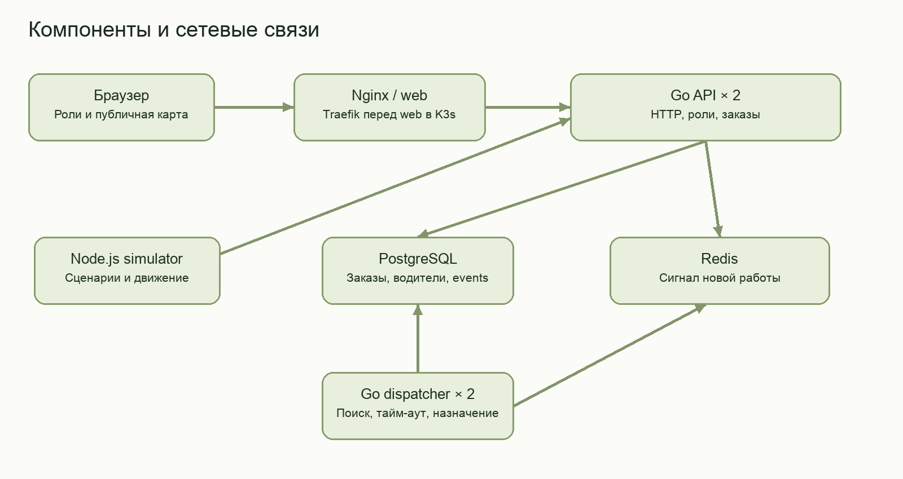
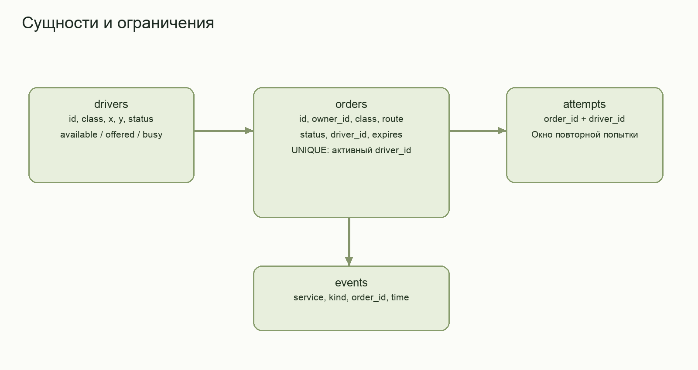
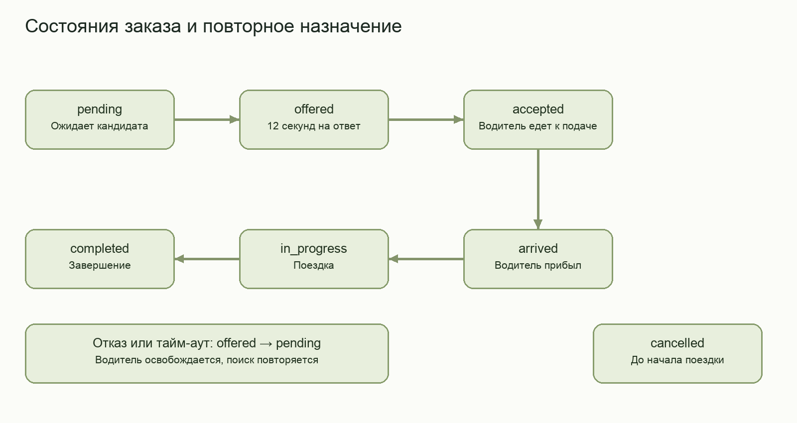
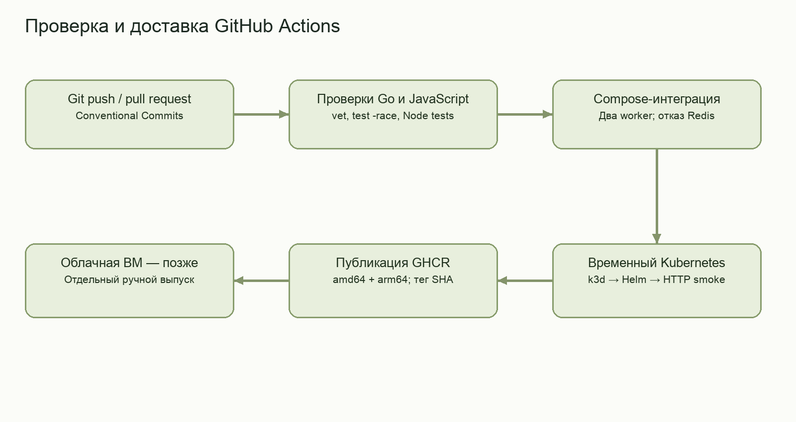
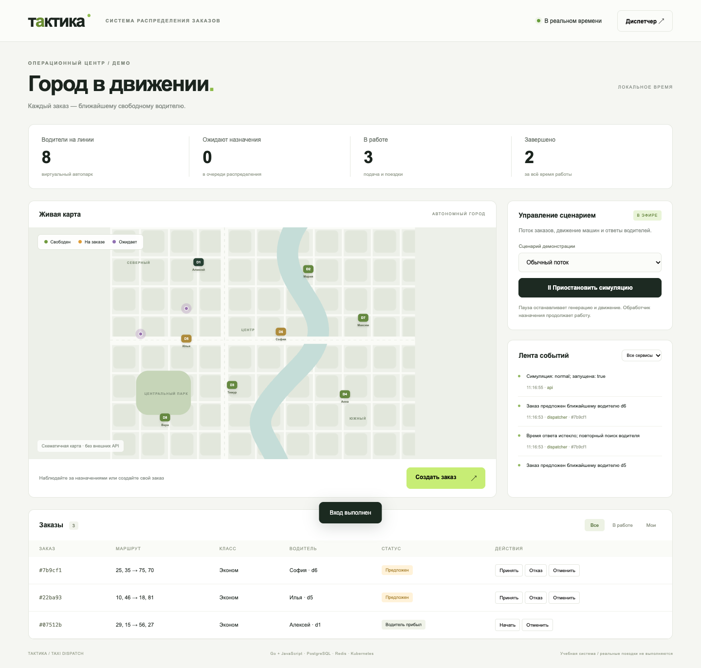

# АННОТАЦИЯ

Курсовая работа посвящена настройке и администрированию системы автоматической обработки и распределения заказов для службы такси. Разработан учебный программный комплекс «Тактика», включающий серверные компоненты на Go, браузерный интерфейс на JavaScript и симулятор на Node.js. Хранение данных организовано в PostgreSQL, ускоряющие уведомления передаются через Redis.

Реализованы поиск ближайшего подходящего свободного водителя, предложение заказа с ограничением времени ответа, отказ и повторное назначение. Корректность изменения состояния обеспечивается транзакциями, блокировками и ограничениями базы данных. Для демонстрации предусмотрены наблюдатель, пассажир, водитель и диспетчер, автономная анимированная карта и журнал событий.

Настроены шесть компонентов Docker Compose, локальный кластер Kubernetes на базе K3s/k3d, параметризованный Helm chart и конвейер GitHub Actions. Выполнены модульные, интеграционные и браузерные проверки, проверены работа без Redis, восстановление подов и восстановление резервной копии. Подготовлены конфигурации будущего облачного развёртывания, домена и HTTPS. Облачные ресурсы в рамках проведённых испытаний не создавались.

Ключевые слова: КОНТЕЙНЕРИЗАЦИЯ, DOCKER, KUBERNETES, РАСПРЕДЕЛЕНИЕ ЗАКАЗОВ, GO, POSTGRESQL, CI/CD, АДМИНИСТРИРОВАНИЕ.

# ТЕРМИНЫ И ОПРЕДЕЛЕНИЯ

Контейнер — изолированный экземпляр приложения, запускаемый из образа с заданными параметрами среды.

Образ — пакет файловой системы и метаданных, используемый для создания контейнера.

Кластер — совокупность узлов, управляемых как единая вычислительная среда.

Под — минимальная планируемая единица Kubernetes, объединяющая один или несколько контейнеров.

Диспетчеризация — выбор исполнителя заказа с учётом доступности, класса обслуживания и положения автомобиля.

Транзакция — группа операций базы данных, фиксируемая или отменяемая как единое целое.

Доменное событие — зафиксированный факт изменения бизнес-состояния, например принятие заказа водителем.

Релиз Helm — установленный экземпляр пакета конфигурации Kubernetes с собственными параметрами и историей изменений.

# ПЕРЕЧЕНЬ СОКРАЩЕНИЙ И ОБОЗНАЧЕНИЙ

БД — база данных.

ВМ — виртуальная машина.

ОС — операционная система.

ПО — программное обеспечение.

API — Application Programming Interface, программный интерфейс приложения.

CI/CD — Continuous Integration / Continuous Delivery, непрерывная интеграция и доставка программного обеспечения.

DNS — Domain Name System, система доменных имён.

HTTP — Hypertext Transfer Protocol, протокол передачи гипертекста.

HTTPS — HTTP с защитой транспортного соединения посредством TLS.

JSON — JavaScript Object Notation, текстовый формат представления структурированных данных.

PVC — PersistentVolumeClaim, запрос постоянного хранилища Kubernetes.

SQL — Structured Query Language, язык структурированных запросов.

TLS — Transport Layer Security, протокол защиты транспортного соединения.

# ВВЕДЕНИЕ

Работа службы такси связана с непрерывным поступлением заказов и изменением доступности исполнителей. Ручной выбор автомобиля затрудняет воспроизводимое применение правил, а одновременная обработка нескольких заявок создаёт риск назначения одного водителя на несовместимые поездки. Практическая задача автоматизации включает не только алгоритм поиска, но и сохранность состояния, обработку отказов, наблюдаемость и воспроизводимое развёртывание.

Контейнеризация позволяет упаковать приложение и его зависимости в переносимые образы. Docker предоставляет средства их сборки и запуска [1]. При переходе от одного процесса к нескольким компонентам появляются вопросы сетевого взаимодействия, хранения данных, обновления и восстановления. Kubernetes описывает желаемое состояние нагрузок и поддерживает его средствами контроллеров [2]. Поэтому разработка учебной системы такси представляет собой подходящий объект для изучения настройки и администрирования сервисного ПО.

Цель работы — разработать и настроить контейнеризированную систему автоматической обработки и распределения заказов такси, обеспечивающую демонстрацию бизнес-процесса, кластерного развёртывания и автоматизированной доставки.

Для достижения цели необходимо выполнить анализ предметной области и аналогов; сформировать требования; обосновать технологии; реализовать обработку заказов и интерфейс; организовать не менее пяти контейнеров и их сеть; создать кластерную конфигурацию; настроить CI/CD; проверить штатные и отказные сценарии; подготовить инструкции пользователя и администратора.

Объект исследования — программная инфраструктура автоматизированной диспетчеризации службы такси. Предмет исследования — методы настройки контейнерных компонентов, согласованного распределения заказов, кластерного запуска и доставки изменений.

Применяются анализ документации, сравнительная оценка инструментов, моделирование состояний, проектирование реляционной схемы, транзакционная обработка и экспериментальная проверка. Реальные пассажирские перевозки, платежи и обработка персональных данных не входят в область работы. Основное внимание уделяется механизмам распределения и эксплуатации. Практический результат представляет собой работающий учебный стенд, исходный код, конфигурации инфраструктуры и подтверждённые проверки.

# 1 АНАЛИЗ ПРЕДМЕТНОЙ ОБЛАСТИ

## 1.1 Процесс обработки заказа

Заказ содержит точку подачи, точку назначения и класс обслуживания. Водитель характеризуется идентификатором, классом автомобиля, координатами и состоянием доступности. После регистрации заказа система должна выбрать исполнителя, получить подтверждение и последовательно зафиксировать подачу, начало и завершение поездки.

Основной инвариант состоит в отсутствии у водителя нескольких активных заказов. Дополнительные требования связаны с соответствием класса, запретом недопустимых переходов состояния и сохранением заказа при перезапуске процесса. Отказ водителя или отсутствие ответа не должны оставлять заявку в неопределённом состоянии: требуется повторный поиск с исключением немедленного предложения тому же исполнителю.

Выбор ближайшего автомобиля является понятным исходным правилом, но его необходимо рассматривать в контексте модели. На реальной дорожной сети кратчайшее геометрическое расстояние не обязательно означает минимальное время подачи. Для учебного стенда используется двумерная схема города без пробок и внешнего геокодирования. Это ограничение явно отделяет демонстрацию механизма от промышленной маршрутизации.

Поток заказов и движение автомобилей моделируются отдельным компонентом. Такой подход позволяет повторяемо исследовать обычный режим, отказы, недостаток отвечающих водителей и всплеск нагрузки. Симуляция формирует запросы к тому же API, что и пользователь, поэтому демонстрирует фактическую обработку, а не заранее подготовленную анимацию.

## 1.2 Аналоги и сравнительный анализ

В качестве функционального аналога рассмотрен программный комплекс «Такси-Мастер». На официальном сайте представлены приём и распределение заказов, инструменты водителя и пассажира, тарифные настройки и отчётность [3]. Для учебной задачи полезны разделение ролей и фиксация событий. Полный финансовый и организационный функционал коммерческого комплекса выходит за пределы выбранного объёма.

В материалах «Яндекс Про» описано автоматическое распределение с учётом подходящего автомобиля, возможности подачи и приоритета водителя [4]. Сведения используются для определения наблюдаемых требований, а не для утверждений о внутреннем стеке или закрытых алгоритмах сервиса. Разработанная модель сохраняет проверку класса и доступности, но не воспроизводит коммерческую систему приоритетов.

Ручная диспетчеризация рассматривается как исходный организационный подход. Её преимущество — возможность ситуативного решения человеком; недостаток для учебного эксперимента — зависимость от оператора и отсутствие формально воспроизводимого алгоритма. Автоматизированная модель должна дополняться инструментами наблюдения и возможностью ручного прохождения этапов водителем.

Таблица 1 — Сравнение подходов к диспетчеризации
| Подход | Полезные свойства | Ограничения для данной работы |
| Ручная диспетчеризация | Гибкость решений оператора | Трудно воспроизводить конкуренцию и поток |
| Такси-Мастер | Комплексные роли, распределение, отчёты | Избыточный бизнес-объём для учебного стенда |
| Яндекс Про | Автоматический подбор и учёт условий | Закрытые внутренние механизмы не исследуются |
| Тактика | Открытый код, симуляция, проверяемая инфраструктура | Схематичный город и одиночная БД |

На основании сравнения выбран самостоятельный учебный комплекс. Его назначение заключается в прозрачной демонстрации алгоритма и эксплуатации, а не в функциональном превосходстве над коммерческими аналогами.

## 1.3 Функциональные и эксплуатационные требования

Наблюдатель должен видеть состояние парка и события без авторизации. Пассажиру требуется создать заказ и отменить принадлежащую ему заявку до начала поездки. Водитель должен принимать только назначенное ему предложение, отмечать прибытие, начало и завершение. Диспетчеру предоставляется управление глобальным сценарием и возможность демонстрационного вмешательства.

Система должна назначать ближайшего свободного совместимого водителя, ограничивать время ответа и повторять поиск при отказе. При отсутствии кандидата заказ остаётся в очереди. Несколько фоновых обработчиков не должны нарушать целостность. Сохранение заказа должно происходить раньше отправки уведомления о новой работе.

Эксплуатационные требования включают локальный запуск на компьютерах с Docker Desktop, кластерную конфигурацию, изолированную внутреннюю сеть, постоянное хранилище PostgreSQL, структурированные логи, резервное копирование, проверки готовности и безопасное завершение процессов. Публичный запуск требует доменного имени, HTTPS, ограничения частоты запросов и закрытого управления.

Таблица 2 — Требования и способы проверки
| Требование | Проверяемое подтверждение |
| Корректное назначение | Проверка ближайшего водителя и уникальности активных назначений |
| Обработка отказов | Смена driver_id после decline и offer_expired |
| Работа без Redis | Повторный интеграционный прогон при остановленном Redis |
| Кластер | Deployment/Service/Ingress и несколько узлов k3d |
| Доставка | Установка Helm во временный кластер GitHub Actions |
| Сохранность | Дамп и восстановление в отдельную БД |

## 1.4 Выводы по анализу

Предметная область требует согласованного управления состоянием, а не только визуального выбора автомобиля на карте. Критическими являются запрет двойного назначения, явный жизненный цикл и восстановление после неответившего исполнителя. Для исследования этих свойств достаточно ограниченного автопарка и синтетических заказов.

Инфраструктура должна обеспечивать воспроизводимое создание окружения и наблюдение за компонентами. Поэтому в практическую часть включены контейнерные образы, Compose, Kubernetes, Helm и конвейер проверки доставки. Бизнес-функции оплаты, рейтинга и программ лояльности исключены, поскольку не помогают проверить выбранные эксплуатационные свойства.

Результат анализа — перечень проверяемых требований и границы модели. На их основании далее определяется архитектура и выбираются технологии.

# 2 ПРОЕКТИРОВАНИЕ И ВЫБОР ТЕХНОЛОГИЙ

## 2.1 Архитектура программного комплекса

Система разделена на шесть логических компонентов. Go API принимает запросы и контролирует права; Go dispatcher выполняет подбор водителя; Node.js simulator создаёт поток и перемещает виртуальные машины; Nginx раздаёт JavaScript-интерфейс и проксирует API; PostgreSQL хранит состояние; Redis ускоряет обнаружение новой работы.

Go выбран для серверных компонентов благодаря статической типизации, стандартному HTTP-пакету и возможности получения самостоятельного бинарного файла [5]. Node.js позволяет реализовать серверный симулятор на JavaScript с асинхронными HTTP-запросами [6]. Браузерный интерфейс ограничен одним основным экраном и использует стандартные модули JavaScript без отдельного фреймворка и сборщика.

API и dispatcher собираются из общего Go-модуля, но запускаются отдельными процессами с разными ролями. Такое разделение отделяет приём запросов от фоновой работы, сохраняя единую модель хранения. Общая PostgreSQL соответствует учебному объёму; независимость микросервисных баз данных не заявляется.

На рисунке 1 показаны связи компонентов. Внешний пользователь обращается только к веб-точке входа. Simulator использует внутренний API, а dispatcher взаимодействует с общей БД и Redis. Публичные события не дают доступа к техническим секретам процессов.



## 2.2 Обоснование технологического комплекса

PostgreSQL предоставляет транзакции, блокировки и частичные уникальные индексы, необходимые для ограничения активных назначений [7]. В отличие от файлового хранения, она поддерживает согласованную работу нескольких процессов. Redis используется в роли ограниченной очереди уведомлений, что соответствует доступным операциям списков [8]. Полноценный журнал брокера для выбранной модели не требуется, поскольку задания восстанавливаются из PostgreSQL.

Nginx выбран как веб-сервер статических ресурсов и обратный прокси. Его конфигурация централизует путь к API, ограничения запросов и формат доступа [9]. Использование отдельного прокси около каждого Go-пода не даёт необходимого преимущества для данной системы: распределение на реплики обеспечивает Kubernetes Service.

Таблица 3 — Сравнение вариантов реализации
| Задача | Рассмотренные варианты | Выбор и основание |
| Сервер обработки | Go, Node.js | Go: типы, HTTP, единый бинарник |
| Симулятор | Браузер, сервер Node.js | Node.js: работа независимо от вкладки |
| Хранилище | Файлы, SQLite, PostgreSQL | PostgreSQL: конкурентные транзакции |
| Уведомления | Только polling, Redis, Kafka | Redis + polling: простота и резервный путь |
| Оркестрация | Только Compose, Kubernetes | Compose + Kubernetes: разработка и кластер |
| Интерфейс | Тяжёлый SPA-стек, модули JS | Модули JS: достаточный объём одного экрана |

Выбор основан на соответствии требованиям и стоимости эксплуатации, а не на произвольном суммировании экспертных баллов. Kafka, платёжный сервис и отдельный BFF не включены, поскольку для них отсутствует необходимая самостоятельная функция в выбранной постановке.

## 2.3 Схема данных и ограничения целостности

Таблица drivers содержит координаты и состояние водителя. Таблица orders хранит владельца, маршрут, класс, состояние, исполнителя и срок предложения. Attempts исключает немедленное повторное предложение после отказа. Events сохраняет доменные факты, demo_settings — общий режим симуляции.

Внешний ключ запрещает назначение отсутствующего водителя. CHECK ограничивает набор классов и состояний. Частичный уникальный индекс по driver_id действует только для offered, accepted, arrived и in_progress. Поэтому история завершённых поездок не мешает новому назначению, но два активных заказа одному водителю запрещены самой БД.

Публичная выдача формируется явно: owner_id и параметры аутентификации исключены, вместо идентификатора пассажира возвращается только признак mine для текущей сессии. Это отделяет внутреннее хранение от наблюдаемого контракта.

Инициализация схемы выполняется идемпотентно под отдельной транзакционной advisory-блокировкой. Для первой версии такой механизм достаточен. Последующие несовместимые изменения потребуют последовательных версионированных миграций: CREATE IF NOT EXISTS не проверяет соответствие всей существующей структуры новым ожиданиям.

На рисунке 2 представлены основные сущности и связи. Журнал events содержит идентификатор заказа для сопоставления действий; история попыток связана с конкретной парой заказа и водителя.



## 2.4 Алгоритм назначения и переходы состояний

Для заказа выбираются available-водители совместимого класса без недавней попытки. Автомобиль comfort может выполнить economy, обратная замена запрещена. Кандидаты сортируются по квадрату евклидова расстояния от текущего положения к подаче. При равенстве используется идентификатор водителя. Для схемы города порядок расстояний определяется выражением d² = (xв − xп)² + (yв − yп)².

В начале цикла dispatcher получает транзакционную advisory-блокировку координатора. Другой экземпляр при занятой блокировке пропускает итерацию. Затем обрабатываются истёкшие предложения и выбирается старейший заказ, для которого существует кандидат. Заказ и водитель блокируются, обновляются и фиксируются в одной транзакции.

Использование FOR UPDATE SKIP LOCKED позволяет не ждать строку, занятую другой операцией. Частичный индекс остаётся дополнительной защитой при ошибке прикладного алгоритма. Два dispatcher обеспечивают резервирование процессов, однако критический участок сериализован; линейное увеличение производительности от числа реплик не предполагается.

Предложение действует 12 секунд по умолчанию. Accept проверяет срок на сервере. Отказ или истечение возвращают заказ в pending и освобождают водителя. Через 30 секунд давняя попытка перестаёт исключать кандидата, чтобы после отказов всего парка заказ не оказался навсегда заблокированным.

На рисунке 3 показан автомат состояний. Начиная с in_progress, отмена в данной модели запрещена. Повторное принятие завершённого заказа возвращает конфликт и не создаёт новый переход.



## 2.5 Уведомления и поведение при сбоях

API сначала фиксирует заказ и событие в PostgreSQL, затем отправляет сигнал Redis. Сигнал не является единственной копией задания. Если процесс завершится между commit и уведомлением, dispatcher найдёт pending-заказ периодическим сканированием. Если Redis недоступен, ожидание уведомления ограничено, а работа продолжается через БД.

Для списка Redis применяются LPUSH, ограничение длины LTRIM и блокирующее чтение BRPOP. В списке достаточно условного сигнала, поскольку сам набор работ определяется SQL-запросом. Persistence Redis отключена сознательно; постоянный том требуется PostgreSQL.

Такая схема не является распределённой транзакцией и не обещает exactly-once доставку сообщений. Корректность бизнес-состояния достигается транзакциями и допустимыми переходами. В API создания заказа пока отсутствует idempotency key, поэтому клиент не выполняет автоматический повтор POST после неопределённого сетевого исхода.

Отказ SQL-транзакции оставляет заказ в прежнем согласованном состоянии. Перезапуск worker не теряет очередь, поскольку она выражена строками PostgreSQL. Потеря единственного диска БД этими механизмами не покрывается и требует независимого резервного копирования.

## 2.6 Контейнерная и кластерная инфраструктура

Compose описывает шесть компонентов, внутреннюю backend-сеть, внешнюю точку web и именованный том PostgreSQL. Порт 8088 публикуется только на loopback. API, dispatcher и simulator используют отдельные процессы с непривилегированными пользователями. Прикладные контейнеры имеют read-only файловую систему и необходимые временные каталоги.

Для локального Kubernetes выбран k3d, запускающий K3s-узлы в Docker. Конфигурация задаёт один server и два agent [10]. Это позволяет изучать обычные Kubernetes-ресурсы без отдельного набора физических машин. В облаке предполагается непосредственная установка K3s на Linux-ВМ.

Helm chart параметризует образы, число реплик, домен, TLS и storage [11]. API, web и dispatcher имеют по две реплики; simulator — одну со стратегией Recreate. PostgreSQL развёрнут StatefulSet с PVC local-path. БД одиночная, а данные привязаны к узлу. Отказоустойчивость диска и управляющего узла не заявляется.

Readiness API зависит от PostgreSQL, liveness — от жизни HTTP-процесса. Redis не включён в обязательную готовность, поскольку предусмотрен резервный путь. NetworkPolicy ограничивает namespace и разрешает необходимые связи, DNS и вход Traefik к web.

## 2.7 Конвейер доставки и будущий публичный доступ

Конвейер GitHub Actions запускается при push в main и pull request. Возможности workflow, jobs и разрешений описаны в документации платформы [12]. Сначала выполняются проверки Go/JS, затем Compose-интеграция с двумя dispatcher и отказом Redis. После этого создаётся временный k3d-кластер, выполняется Helm-установка и повторный HTTP-сценарий через Ingress.

После успеха в main публикуются три образа app, web и simulator для linux/amd64 и linux/arm64. Тег связывается с SHA коммита. Доставка в временный кластер подтверждает развёртываемость, но не означает автоматический выпуск на облачную ВМ. Облачный запуск оставлен отдельным этапом согласно границам работы.

Для публичного стенда подготовлены доменная маршрутизация, Secure cookie и конфигурация ACME через cert-manager [13]. Terraform-заготовка описывает ВМ, сеть и правила доступа Yandex Cloud; модель ресурсов согласуется с документацией провайдера [14]. Открываются только HTTP/HTTPS и SSH с доверенного адреса. PostgreSQL, Redis и административный Kubernetes API в интернет не публикуются.

На рисунке 4 приведены этапы автоматизированной проверки и публикации. Реальные секреты не включаются в образы или репозиторий; временный Secret создаётся на runner через stdin.



# 3 РЕАЛИЗАЦИЯ, НАСТРОЙКА И ПРОВЕРКА

## 3.1 Реализация Go-компонентов

Входная точка cmd/taxi настраивает JSON-логирование, контекст остановки, соединения и роль процесса. Для API создаётся HTTP-сервер с ограничениями размера заголовков и времени ожидания. Dispatcher запускает цикл SQL-обработки и ожидания Redis-уведомлений. SIGTERM и SIGINT инициируют корректное завершение.

Пакет internal содержит правила переходов, слой хранения, SQL-схему и HTTP-обработчики. Параметры SQL передаются отдельно от текста запроса. Клиентская ошибка не приводит к возврату SQL-деталей; техническая информация фиксируется в закрытом служебном логе.

POST /api/orders проверяет роль, маршрут и класс. Транзакционная блокировка приёма позволяет ограничить глобальное число активных и новых заказов при нескольких API-репликах. На гостя допускаются не более двух активных заявок. Ограничения защищают демонстрационный стенд от неограниченного накопления работы, но не заменяют полноценную противодействующую распределённым атакам инфраструктуру.

POST /api/orders/{id}/{action} блокирует заказ, проверяет владельца или driver_id и применяет единственный допустимый переход. После изменения события и состояния фиксируются вместе. Уведомление фонового обработчика отправляется после commit.

Таблица 4 — Основные интерфейсы
| Метод и путь | Назначение |
| GET /api/state | Публичный snapshot и события |
| POST /api/auth/guest | Сессия пассажира |
| POST /api/auth/login | Вход диспетчера или водителя |
| POST /api/orders | Создание заказа |
| POST /api/orders/{id}/{action} | Переход состояния |
| POST /api/simulation | Управление сценарием диспетчером |
| GET /healthz, /readyz | Жизнь и готовность API |

## 3.2 Интерфейс и симулятор

Интерфейс содержит счётчики, карту, сценарий, ленту событий и таблицу заказов. Карта построена на SVG без внешних картографических API, поэтому локальная демонстрация не зависит от интернета. Положение маркеров изменяется плавно через CSS-переходы; направления показаны пунктирными связями.

Состояние запрашивается каждые 1,5 секунды; скрытая вкладка пропускает опрос. Для ограниченного стенда polling выбран вместо постоянного WebSocket-канала. Это упрощает реализацию, но нагрузка чтения растёт с числом наблюдателей. Вставка сообщений выполняется через textContent и не интерпретирует их как HTML.

Node.js simulator выполняет последовательный асинхронный цикл. Он читает общие настройки, создаёт заказы, отвечает на предложения и перемещает машины к подаче либо назначению. Чистые функции движения и генерации вынесены отдельно и тестируются без HTTP. Псевдослучайный seed делает поток маршрутов воспроизводимым; секреты генерируются другим, криптографическим механизмом.

В обычном режиме водители принимают предложения. Сценарий отказов добавляет вероятностный decline. При дефиците автоматически отвечают только d1/d2, остальные предложения истекают. Всплеск создаёт группы заявок и показывает очередь. Пауза останавливает автоматическое движение и генерацию, но не dispatcher.

На рисунке 5 представлен фактический интерфейс работающего стенда. Скриншот получен браузерной проверкой локального приложения, а не графическим макетом.



## 3.3 Настройка Docker Compose

Созданы отдельные Dockerfile backend, web и simulator. Backend использует многостадийную сборку: компилятор остаётся в build-стадии, runtime получает бинарный файл. Nginx запускается на непривилегированном порту 8080, а Compose публикует 8088 на хосте. Node.js запускается напрямую без промежуточной shell-команды.

Перед запуском node scripts/setup.mjs создаёт локальный .env со случайными ключами и паролями, если файл отсутствует. Повторный запуск существующий файл не перезаписывает. Рабочий .env исключён из Git и build context. Контейнеры получают конфигурацию при запуске.

Команда docker compose up -d --build --wait создаёт сеть, том, образы и процессы. Для PostgreSQL и Redis заданы проверки доступности. API ожидает начальную готовность зависимостей в Compose. Логи каждого компонента выводятся в stdout/stderr с ротацией файлов Docker.

В ходе проверки подняты два экземпляра dispatcher. Штатная остановка docker compose down сохраняет том PostgreSQL. Удаление томов не включается в обычную инструкцию: оно уничтожило бы накопленные заказы.

Листинг 1 — Основные команды локального запуска
```sh
node scripts/setup.mjs
docker compose up -d --build --wait
docker compose logs -f --tail=100 api dispatcher simulator
node scripts/smoke.mjs
docker compose down
```

## 3.4 Настройка Kubernetes и Helm

Локальный кластер создан k3d по отдельному конфигурационному файлу. Узлы server и два agent имеют состояние Ready. Собранные образы импортированы во внутренний runtime узлов. Kubernetes-контекст основного окружения не изменялся: для проверки использован отдельный kubeconfig.

В namespace taxi создан Secret без вывода его значений. Helm установил релиз со StatefulSet PostgreSQL, Redis, Deployment приложений, Service, ConfigMap, Ingress и NetworkPolicy. После ожидания готовности доступ осуществлялся через taxi.localhost:8089.

Проверка размещения показала реплики приложений на разных узлах. Удалённые API-поды были автоматически созданы заново, и rollout завершился успешно. Эксперимент подтверждает механизм поддержания числа реплик; непрерывность каждого клиентского запроса при одновременном удалении всех API-подов не утверждается.

Helm lint и рендеринг шаблонов завершились без ошибок. При этом статическая проверка рассматривается только как предварительная: фактическая установка и интеграционные запросы являются отдельными этапами подтверждения.

Листинг 2 — Установка приложения в кластер
```sh
k3d cluster create --config deploy/k3d.yaml
k3d image import taxi-app:local taxi-web:local taxi-simulator:local -c taxi
kubectl create namespace taxi
node scripts/kube-secret.mjs | kubectl apply -f -
helm upgrade --install taxi deploy/helm/taxi -n taxi --wait --timeout 180s
kubectl get pods -n taxi -o wide
```

## 3.5 Реализация и проверка CI/CD

Исходники размещены в публичном репозитории Alexey-UI/taxi-dispatch-coursework. Коммиты оформлены по Conventional Commits. Учебные материалы автора хранятся вне репозитория, а секреты исключены из отслеживания.

Первый полный конвейер GitHub Actions № 40655602805 завершился успешно. Job test выполнил Go-проверки с race detector, Node.js-тесты, Compose-интеграцию, проверку без Redis, создание временного k3d-кластера и доставку через Helm. Затем все три publish-job успешно опубликовали многоархитектурные образы.

Для проверенного запуска использован коммит 3f3d3e5aa151af0c58e1dade676cd94a1271c701. Результат доступен по адресу https://github.com/Alexey-UI/taxi-dispatch-coursework/actions/runs/40655602805. Указание конкретного запуска позволяет отличить реальный эксперимент от описания планируемого pipeline.

При повторном запуске выявлена гонка готовности внешнего Ingress: установка приложения уже завершилась, но первое соединение сбрасывалось. Перед изменяющими запросами добавлено ограниченное ожидание безопасного GET /api/state. Исправленный конвейер № 40660991452 завершился успешно. Этот эксперимент показывает необходимость проверки внешнего маршрута дополнительно к готовности прикладных подов.

Cloud deployment автоматически не выполняется. Подготовленные конфигурации требуют значения домена, параметров ВМ, новых секретов и отдельного решения оператора. Тем самым CI/CD подтверждён для временной тестовой инфраструктуры и публикации артефактов; эксплуатация публичной ВМ остаётся будущим этапом.

## 3.6 Испытания и результаты

Модульные проверки Go охватывают жизненный цикл и запрещённые переходы, допустимость координат и базовые свойства подписи. Тесты Node.js проверяют движение без перелёта цели и воспроизводимую генерацию допустимых маршрутов. В GitHub Actions Go-тесты дополнительно выполнены с race detector.

Сквозной сценарий создаёт заказ у свободного автомобиля comfort и проверяет выбор ближайшего кандидата. Далее выполняются отказ, новое назначение, полный цикл поездки и отказ повторного accept после завершения. Создание группы заказов при двух dispatcher проверяет уникальность активных driver_id; ожидание тайм-аута подтверждает событие offer_expired.

Отдельно проверяются запрет управления симуляцией наблюдателем, запрет чужой отмены пассажиром и отсутствие owner_id в публичной выдаче. Повторный прогон при остановленном Redis подтвердил резервное распределение. Прогон через Kubernetes Ingress подтвердил сетевой путь кластерного стенда.

Таблица 5 — Фактические результаты испытаний
| Проверка | Полученный результат |
| Go vet и модульные тесты | Успешно; race detector также выполнен в CI |
| Node.js, два теста движка | Успешно |
| Compose, два dispatcher | Успешно, 60 HTTP-проверок в первом прогоне |
| Redis остановлен | Успешно, 58 HTTP-проверок |
| Kubernetes Ingress | Успешно, 59 HTTP-проверок |
| Браузер desktop/mobile | Вход, симуляция, заказ; pageerror отсутствуют |
| Восстановление API | Deployment создал готовые реплики |
| Восстановление dump | Отдельная БД восстановлена; проверено 30 заказов |
| GitHub Actions | Test и три publish-job завершились успешно |

Число HTTP-запросов зависит от ожиданий и не характеризует производительность. Нагрузка, p95 и отказы диска либо хоста не исследовались.

## 3.7 Инструкция пользователя и администратора

Наблюдатель открывает главную страницу и видит общую карту. Для создания заявки выбирается действие «Создать заказ», после чего создаётся гостевая сессия. Точки задаются численно либо двумя нажатиями на карте. В таблице отображаются состояние и назначенный водитель; пассажир может отменить свою заявку до начала поездки.

Диспетчер входит с демонстрационным паролем из локальной конфигурации, выбирает сценарий и запускает поток. Для ручной проверки водителя симуляция ставится на паузу. Водитель входит с выбранным driver_id, принимает предложение и последовательно отмечает этапы. Изменения проверяются сервером независимо от видимости кнопок.

Администратор просматривает docker compose logs либо kubectl logs с фильтром компонента. Для ошибочного пода используются describe и previous logs. 404 на Ingress требует проверки Host; 502 — готовности upstream; Pending — ресурсов и PVC. Повторный запуск с удалением данных не используется как универсальное исправление.

Резервная копия создаётся pg_dump в custom-format и проверяется pg_restore в отдельную БД. Рабочий dump не включается в репозиторий. Для длительного публичного стенда необходимы независимое хранение бэкапов, регламент очистки events/orders и контроль свободного диска.

HTTPS-подготовка включает DNS A на закреплённый IP, доступность 80/443, cert-manager и TLS-секрет Ingress. Проверка из внешней сети является обязательным будущим подтверждением публичной доступности; локальная проверка не заменяет её.

## 3.8 Ограничения и направления развития

Система использует синтетические координаты и евклидово расстояние. Для настоящего города потребуются геокодирование, дорожная маршрутизация и актуальные позиции. Общий демонстрационный пароль заменяется персональными учётными записями и управлением сессиями. Создание заказа дополняется idempotency key.

Dispatcher сериализует критический участок. При увеличении парка возможны пространственные индексы и разделение по зонам, но любое изменение стратегии должно сохранять глобальное ограничение активных назначений. Нагрузка наблюдателей может потребовать инкрементальной выдачи или событийного канала вместо полного polling.

PostgreSQL остаётся единственной точкой хранения. Для промышленной доступности необходимы отдельное проектирование репликации, распределённое либо управляемое хранилище, резервирование узлов и проверенный failover. Эти меры не подменяются увеличением числа прикладных подов.

Выявленные ограничения соответствуют учебному назначению и не препятствуют демонстрации требований курсовой работы. Их явное описание позволяет определить границы подтверждённых результатов и план дальнейшего развития.

# ЗАКЛЮЧЕНИЕ

Цель работы достигнута в пределах учебного стенда: разработана и настроена контейнеризированная система автоматической обработки и распределения заказов такси. Сформированы требования, выполнен анализ аналогов и обоснован технологический комплекс. Реализованы Go API и dispatcher, JavaScript-интерфейс, Node.js simulator, PostgreSQL и Redis.

Механизм назначения выбирает ближайшего свободного совместимого водителя, обрабатывает отказ и тайм-аут, сохраняет явный жизненный цикл. Транзакции, блокировки и частичный уникальный индекс защищают активные назначения. Проверки с двумя обработчиками подтвердили корректность исследованных конкурентных сценариев.

Созданы шесть компонентов Compose и настроена внутренняя сеть. Развёрнут локальный трёхузловой Kubernetes-кластер, установлен Helm-релиз с репликами приложений и постоянным хранилищем БД. Подтверждены восстановление подов и восстановление SQL-дампа в отдельную базу.

Настроен и фактически выполнен GitHub Actions: проверки, Compose-интеграция, доставка в временный кластер и публикация трёх многоархитектурных образов. Подготовлены инструкции, схемы и конфигурации будущей ВМ, домена и HTTPS. Публичный облачный запуск не выполнялся и не включается в подтверждённые результаты.

Практическая значимость заключается в воспроизводимом стенде для изучения распределения заказов и администрирования контейнерных сервисов. Дальнейшее развитие связано с реальной маршрутизацией, индивидуальной аутентификацией, идемпотентным созданием заказов и отказоустойчивым хранением.

# СПИСОК ИСПОЛЬЗОВАННЫХ ИСТОЧНИКОВ

1. Docker Inc. What is Docker? — Текст : электронный. — URL: https://docs.docker.com/get-started/docker-overview/ (дата обращения: 28.10.2026).
2. The Kubernetes Authors. Overview of Kubernetes. — Текст : электронный. — URL: https://kubernetes.io/docs/concepts/overview/ (дата обращения: 28.10.2026).
3. БИТ «Мастер». Программа для такси «Такси-Мастер». — Текст : электронный. — URL: https://www.taximaster.ru/ (дата обращения: 28.10.2026).
4. Яндекс. Как работает приоритет в распределении заказов // Яндекс Про. — Текст : электронный. — URL: https://pro.yandex.ru/ru-ru/moskva/knowledge-base/taxi/income-diff/priority (дата обращения: 28.10.2026).
5. The Go Authors. Documentation. — Текст : электронный. — URL: https://go.dev/doc/ (дата обращения: 28.10.2026).
6. OpenJS Foundation. Node.js documentation. — Текст : электронный. — URL: https://nodejs.org/api/ (дата обращения: 28.10.2026).
7. PostgreSQL Global Development Group. Explicit Locking. PostgreSQL 17 Documentation. — Текст : электронный. — URL: https://www.postgresql.org/docs/17/explicit-locking.html (дата обращения: 28.10.2026).
8. Redis. Redis lists. — Текст : электронный. — URL: https://redis.io/docs/latest/develop/data-types/lists/ (дата обращения: 28.10.2026).
9. NGINX. Module ngx_http_proxy_module. — Текст : электронный. — URL: https://nginx.org/en/docs/http/ngx_http_proxy_module.html (дата обращения: 28.10.2026).
10. k3d contributors. Using Config Files. — Текст : электронный. — URL: https://k3d.io/stable/usage/configfile/ (дата обращения: 28.10.2026).
11. The Helm Authors. Using Helm. — Текст : электронный. — URL: https://helm.sh/docs/intro/using_helm/ (дата обращения: 28.10.2026).
12. GitHub. Understanding GitHub Actions. — Текст : электронный. — URL: https://docs.github.com/en/actions/about-github-actions/understanding-github-actions (дата обращения: 28.10.2026).
13. The cert-manager Authors. HTTP01. — Текст : электронный. — URL: https://cert-manager.io/docs/configuration/acme/http01/ (дата обращения: 28.10.2026).
14. Yandex Cloud. Getting started with Terraform. — Текст : электронный. — URL: https://yandex.cloud/en/docs/terraform/quickstart (дата обращения: 28.10.2026).

# ПРИЛОЖЕНИЕ А. СТРУКТУРА ПРОЕКТА

```text
taxi-dispatch/
  cmd/taxi/             входная точка Go
  internal/             API, правила, хранение, схема и тесты
  web/                  интерфейс и автономная SVG-карта
  simulator/            Node.js и тесты чистых функций
  deploy/               Dockerfile, Nginx, k3d, Helm, Terraform
  scripts/              setup, smoke, browser-check, backup
  docs/                 требования и инструкции
  report/               реферат и презентация
  .github/workflows/    автоматизированные проверки и доставка
```

Полные листинги доступны в публичном репозитории https://github.com/Alexey-UI/taxi-dispatch-coursework. Учебные курсы размещены отдельно от репозитория по требованию автора. Рабочие .env, kubeconfig, дампы и временные инструменты исключены из публикации.

# ПРИЛОЖЕНИЕ Б. СЦЕНАРИЙ ДЕМОНСТРАЦИИ

В течение первой минуты формулируется задача и показываются шесть компонентов. Затем запускается обычный поток и прослеживается один заказ от поиска до завершения. На следующем этапе демонстрируются отказ или тайм-аут и смена исполнителя. После этого показываются поды, логи и успешный запуск GitHub Actions. Завершение доклада включает результаты и ограничения одиночной БД и единственного хоста.

Резервный сценарий использует локальный Compose и автономную карту, если внешняя сеть недоступна. Скриншоты сопровождают живой показ, но не заменяют утверждение о текущей доступности облачного домена. Для ручного принятия заказа симуляция приостанавливается, а водитель входит в отдельной сессии.
