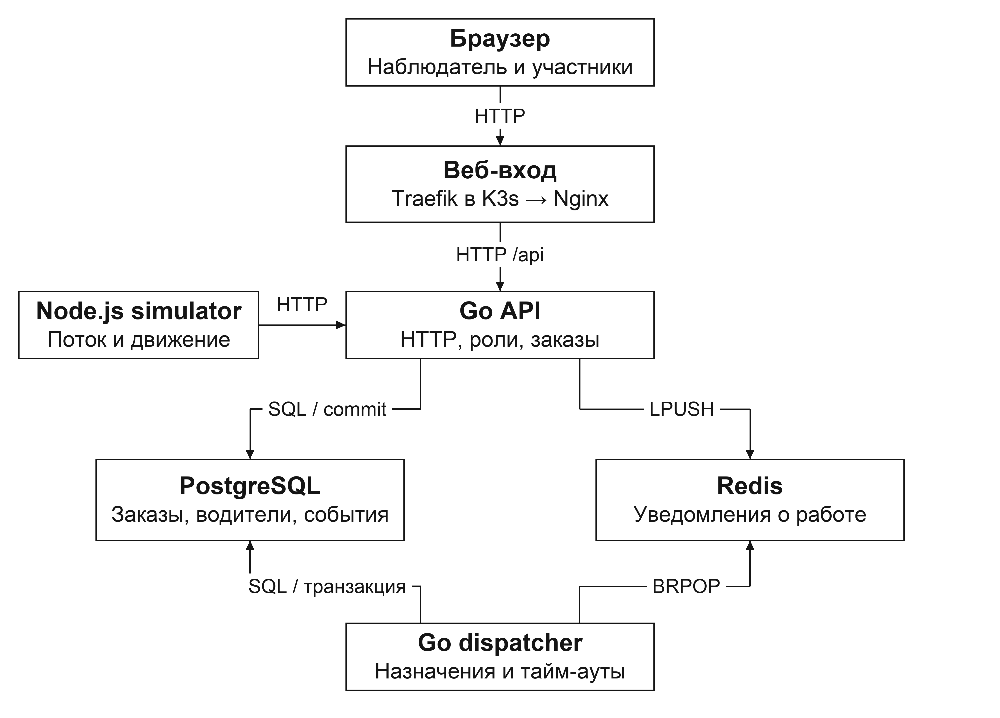
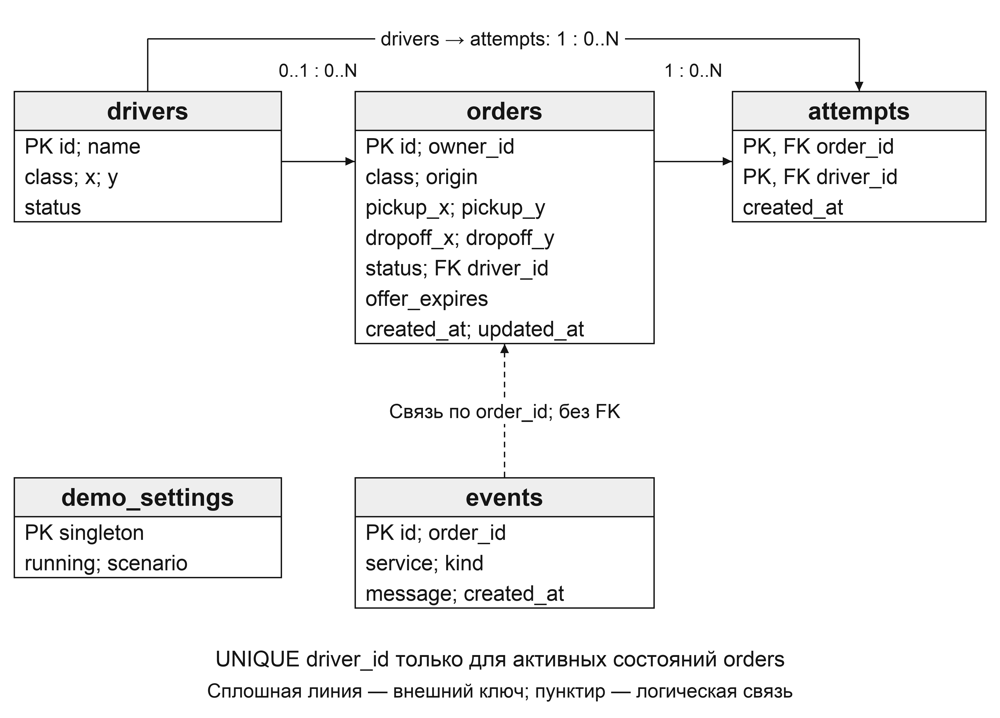
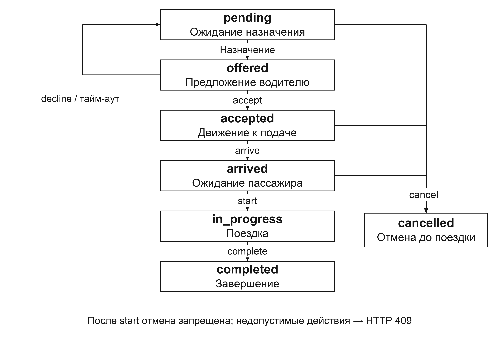
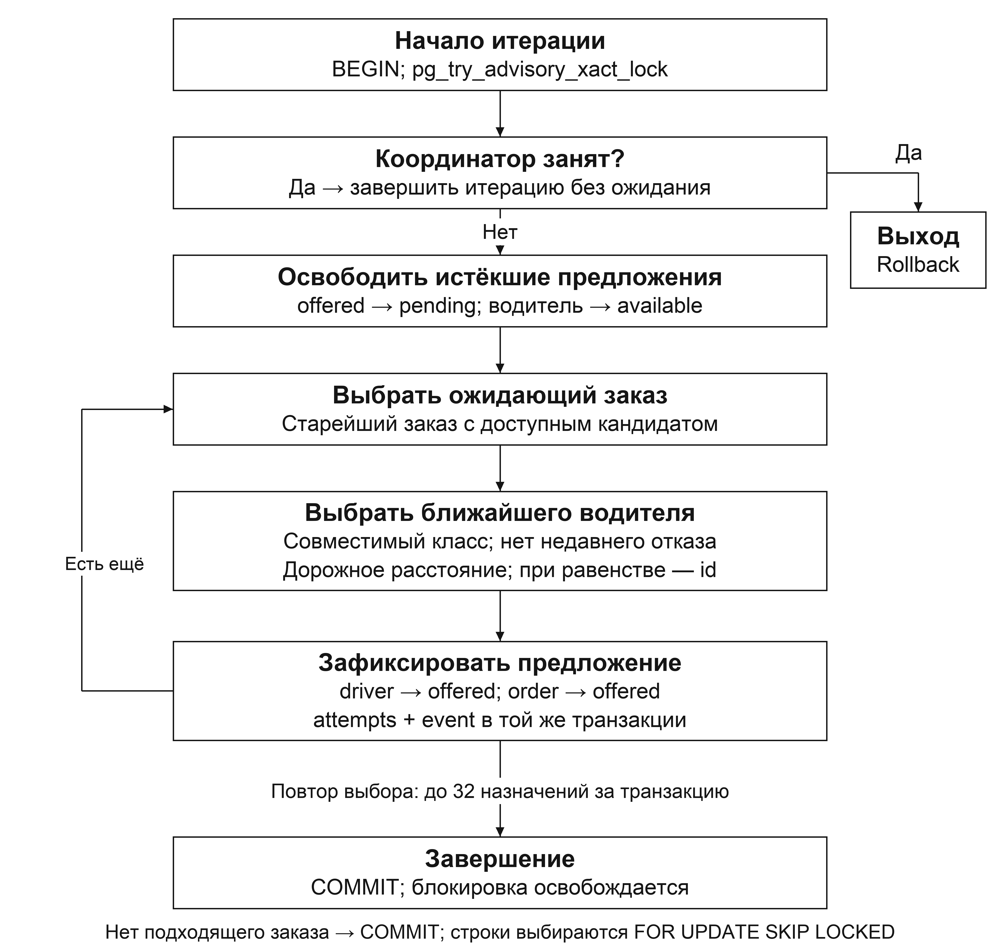
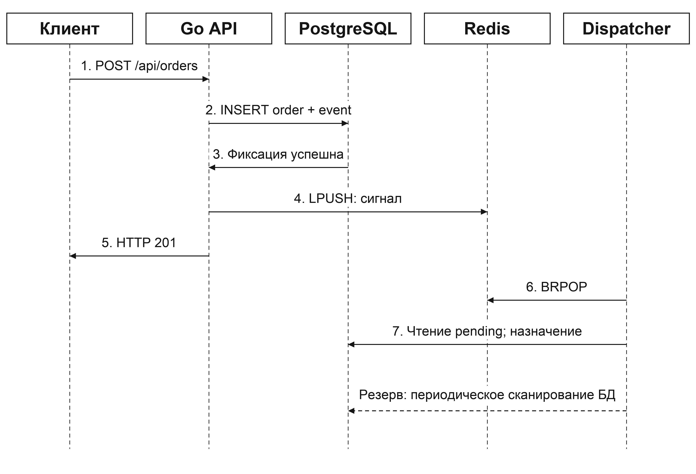
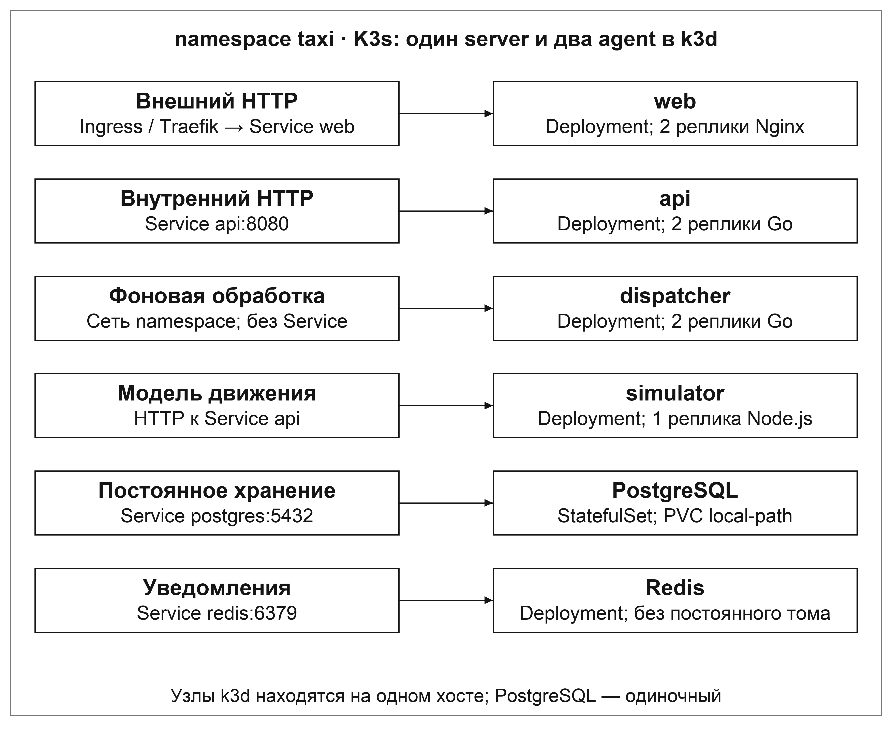
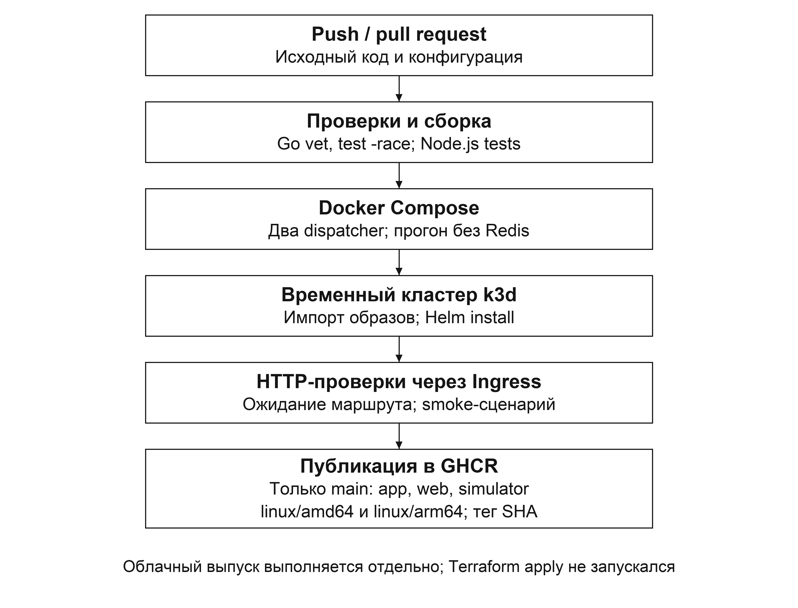
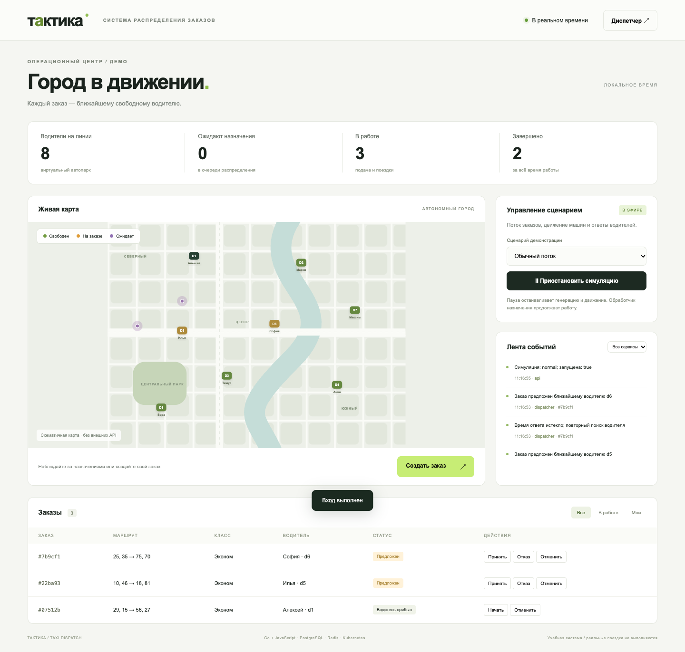

# АННОТАЦИЯ

Курсовая работа посвящена настройке и администрированию системы автоматической обработки и распределения заказов для службы такси. Разработан учебный программный комплекс «Тактика», включающий серверные компоненты на Go, браузерный интерфейс на JavaScript и симулятор на Node.js. Хранение данных организовано в PostgreSQL, ускоряющие уведомления передаются через Redis.

Реализованы поиск ближайшего подходящего свободного водителя, предложение заказа с ограничением времени ответа, отказ и повторное назначение. Корректность изменения состояния обеспечивается транзакциями, блокировками и ограничениями базы данных. Для демонстрации предусмотрены наблюдатель, пассажир, водитель и диспетчер, автономная анимированная карта и журнал событий.

Настроены шесть компонентов Docker Compose, локальный кластер Kubernetes на базе K3s/k3d, параметризованный Helm chart и конвейер GitHub Actions. Выполнены модульные, интеграционные и браузерные проверки, проверены работа без Redis, восстановление подов и восстановление резервной копии. Подготовлены конфигурации для размещения в Yandex Cloud и подключения домена с HTTPS. Испытания проводились локально и в GitHub Actions.

Ключевые слова: КОНТЕЙНЕРИЗАЦИЯ, DOCKER, KUBERNETES, РАСПРЕДЕЛЕНИЕ ЗАКАЗОВ, GO, POSTGRESQL, CI/CD, АДМИНИСТРИРОВАНИЕ.

# ТЕРМИНЫ И ОПРЕДЕЛЕНИЯ

Контейнер — изолированный запуск компонента из образа; например, Go API или Redis в стенде [1].

Образ — файлы и параметры запуска компонента, по которым создаются его контейнеры [1].

Кластер — узлы под общим управлением Kubernetes, на которых работают компоненты стенда [2].

Под — один или несколько контейнеров на общем узле Kubernetes; в стенде — экземпляр компонента [16].

Диспетчеризация — выбор исполнителя заказа с учётом доступности, класса обслуживания и положения автомобиля.

Транзакция — группа операций базы данных, фиксируемая или отменяемая как единое целое.

Доменное событие — зафиксированный факт изменения бизнес-состояния, например принятие заказа водителем.

Релиз Helm — установленный экземпляр пакета конфигурации Kubernetes с собственными параметрами и историей изменений.

# ПЕРЕЧЕНЬ СОКРАЩЕНИЙ И ОБОЗНАЧЕНИЙ

БД — база данных.

ВМ — виртуальная машина.

ОС — операционная система.

ПО — программное обеспечение.

API — Application Programming Interface, программный интерфейс приложения.

CI/CD — Continuous Integration / Continuous Delivery, непрерывная интеграция и доставка программного обеспечения.

DNS — Domain Name System, система доменных имён.

HTTP — Hypertext Transfer Protocol, протокол передачи гипертекста.

HTTPS — HTTP с защитой транспортного соединения посредством TLS.

JSON — JavaScript Object Notation, текстовый формат представления структурированных данных.

PVC — PersistentVolumeClaim, запрос постоянного хранилища Kubernetes.

SQL — Structured Query Language, язык структурированных запросов.

TLS — Transport Layer Security, протокол защиты транспортного соединения.

# ВВЕДЕНИЕ

Работа службы такси связана с непрерывным поступлением заказов и изменением доступности исполнителей. При ручном выборе автомобиля результат зависит от решения диспетчера. Одновременная обработка заявок также создаёт риск назначения одного водителя на несколько поездок. Автоматизированная система должна выбирать исполнителя по заданным правилам, сохранять состояние заказов и продолжать обработку после сбоев.

Контейнеризация позволяет упаковать приложение и его зависимости в переносимые образы. Docker предоставляет средства их сборки и запуска [1]. При переходе от одного процесса к нескольким компонентам появляются вопросы сетевого взаимодействия, хранения данных, обновления и восстановления. Kubernetes описывает желаемое состояние нагрузок и поддерживает его средствами контроллеров [2]. На примере системы такси эти задачи можно рассмотреть совместно: от сборки образов до обновления и восстановления приложения.

Цель работы — разработать и настроить контейнеризированную систему автоматической обработки и распределения заказов такси, обеспечивающую демонстрацию бизнес-процесса, кластерного развёртывания и автоматизированной доставки.

Для достижения цели необходимо выполнить анализ предметной области и аналогов; сформировать требования; обосновать технологии; реализовать обработку заказов и интерфейс; организовать не менее пяти контейнеров и их сеть; создать кластерную конфигурацию; настроить CI/CD; проверить штатные и отказные сценарии; подготовить инструкции пользователя и администратора.

Объект исследования — программная инфраструктура автоматизированной диспетчеризации службы такси. Предмет исследования — методы настройки контейнерных компонентов, согласованного распределения заказов, кластерного запуска и доставки изменений.

Применяются анализ документации, сравнительная оценка инструментов, моделирование состояний, проектирование реляционной схемы, транзакционная обработка и экспериментальная проверка. В работе используются синтетические заказы и координаты; реальные перевозки и платежи не выполняются. Результатом являются учебный стенд, исходный код, конфигурации инфраструктуры и результаты испытаний.

# 1 АНАЛИЗ ПРЕДМЕТНОЙ ОБЛАСТИ

## 1.1 Процесс обработки заказа

Заказ содержит точку подачи, точку назначения и класс обслуживания. Водитель характеризуется идентификатором, классом автомобиля, координатами и состоянием доступности. После регистрации заказа система должна выбрать исполнителя, получить подтверждение и последовательно зафиксировать подачу, начало и завершение поездки.

Основное правило распределения — не более одного активного заказа у водителя. Также необходимо учитывать класс автомобиля, проверять последовательность действий и сохранять заказы при перезапуске процессов. Отказ водителя или отсутствие ответа не должны оставлять заявку в неопределённом состоянии: требуется повторный поиск с исключением немедленного предложения тому же исполнителю.

В основе распределения лежит выбор ближайшего подходящего автомобиля. Расстояние рассчитывается по регулярной уличной сети учебного города. В реальных условиях время подачи зависит также от пробок, направления движения и ограничений на дорогах; эти факторы в модели не учитываются.

Поток заказов и движение автомобилей моделируются отдельным компонентом. Такой подход позволяет повторяемо исследовать обычный режим, отказы, недостаток отвечающих водителей и всплеск нагрузки. Симуляция обращается к тому же API, что и пользователь: создаёт заказы, принимает предложения и изменяет координаты водителей. Анимация отображает полученное состояние.

## 1.2 Аналоги и сравнительный анализ

В качестве функционального аналога рассмотрен программный комплекс «Такси-Мастер». На официальном сайте представлены приём и распределение заказов, инструменты водителя и пассажира, тарифные настройки и отчётность [3]. Для учебной задачи полезны разделение ролей и фиксация событий. Полный финансовый и организационный функционал коммерческого комплекса выходит за пределы выбранного объёма.

В материалах «Яндекс Про» описано автоматическое распределение с учётом подходящего автомобиля, возможности подачи и приоритета водителя [4]. Для разрабатываемой системы из этого описания выделены проверка класса и доступности автомобиля. Приоритеты водителей в учебной модели не используются.

Ручная диспетчеризация рассматривается как исходный организационный подход. Её преимущество — возможность ситуативного решения человеком; недостаток для учебного эксперимента — зависимость от оператора и отсутствие формально воспроизводимого алгоритма. Автоматизированная модель должна дополняться инструментами наблюдения и возможностью ручного прохождения этапов водителем.

Таблица 1 — Сравнение подходов к диспетчеризации
| Подход | Полезные свойства | Ограничения для данной работы |
| Ручная диспетчеризация | Гибкость решений оператора | Трудно воспроизводить конкуренцию и поток |
| Такси-Мастер | Комплексные роли, распределение, отчёты | Избыточный бизнес-объём для учебного стенда |
| Яндекс Про | Автоматический подбор и учёт условий | Закрытые внутренние механизмы не исследуются |
| Тактика | Открытый код, симуляция, проверяемая инфраструктура | Схематичный город и одиночная БД |

На основании сравнения выбран самостоятельный учебный комплекс. В нём можно проследить назначение заказа, изменить сценарий работы и проверить поведение компонентов при сбоях.

## 1.3 Функциональные и эксплуатационные требования

Наблюдатель должен видеть состояние парка и события без авторизации. Пассажиру требуется создать заказ и отменить принадлежащую ему заявку до начала поездки. Водитель должен принимать только назначенное ему предложение, отмечать прибытие, начало и завершение. Диспетчеру предоставляется управление глобальным сценарием и возможность демонстрационного вмешательства.

Система должна назначать ближайшего свободного совместимого водителя, ограничивать время ответа и повторять поиск при отказе. При отсутствии кандидата заказ остаётся в очереди. Несколько фоновых обработчиков не должны нарушать целостность. Сохранение заказа должно происходить раньше отправки уведомления о новой работе.

Эксплуатационные требования включают локальный запуск на компьютерах с Docker Desktop, кластерную конфигурацию, изолированную внутреннюю сеть, постоянное хранилище PostgreSQL, структурированные логи, резервное копирование, проверки готовности и безопасное завершение процессов. Публичный запуск требует доменного имени, HTTPS, ограничения частоты запросов и закрытого управления.

Таблица 2 — Требования и способы проверки
| Требование | Проверяемое подтверждение |
| Корректное назначение | Проверка ближайшего водителя и уникальности активных назначений |
| Обработка отказов | Смена driver_id после decline и offer_expired |
| Работа без Redis | Повторный интеграционный прогон при остановленном Redis |
| Кластер | Deployment/Service/Ingress и несколько узлов k3d |
| Доставка | Установка Helm во временный кластер GitHub Actions |
| Сохранность | Дамп и восстановление в отдельную БД |

## 1.4 Выводы по анализу

При распределении необходимо согласованно изменять состояние заказа и водителя. Основные требования — исключение двойного назначения, последовательная обработка этапов поездки и повторный поиск при отсутствии ответа. Для исследования этих свойств достаточно ограниченного автопарка и синтетических заказов.

Инфраструктура должна обеспечивать воспроизводимое создание окружения и наблюдение за компонентами. Поэтому в практическую часть включены контейнерные образы, Compose, Kubernetes, Helm и конвейер проверки доставки. Функциональность ограничена созданием, распределением и выполнением заказов; оплата, рейтинги и программы лояльности в проект не входят.

Результат анализа — перечень проверяемых требований и границы модели. На их основании далее определяется архитектура и выбираются технологии.

# 2 ПРОЕКТИРОВАНИЕ И ВЫБОР ТЕХНОЛОГИЙ

## 2.1 Архитектура программного комплекса

Система разделена на шесть логических компонентов. Go API принимает запросы и контролирует права; Go dispatcher выполняет подбор водителя; Node.js simulator создаёт заказы и перемещает автомобили на карте; Nginx раздаёт JavaScript-интерфейс и проксирует API; PostgreSQL хранит состояние; Redis ускоряет обнаружение новой работы.

Go выбран для серверных компонентов благодаря статической типизации, стандартному HTTP-пакету и возможности получения самостоятельного бинарного файла [5]. Node.js позволяет реализовать серверный симулятор на JavaScript с асинхронными HTTP-запросами [6]. Браузерный интерфейс ограничен одним основным экраном и использует стандартные модули JavaScript без отдельного фреймворка и сборщика.

API и dispatcher собираются из общего Go-модуля, но запускаются отдельными процессами с разными ролями. Приём запросов и фоновое распределение выполняются независимо, а оба процесса используют общую схему PostgreSQL. Это позволяет сохранять заказ и назначенного водителя в одной транзакции.

В работе А. К. Танаткановой рассмотрены разделение приложения на сервисы и связанные с ним организационные преимущества и трудности [19]. В данном стенде граница проведена по характеру работы: обработка HTTP-запросов отделена от фонового назначения, а согласованность обеспечивается общей БД.

На рисунке 1 показаны связи компонентов. Внешний пользователь обращается только к веб-точке входа. Simulator использует внутренний API, а dispatcher взаимодействует с общей БД и Redis. В браузер передаются состояние заказов и доменные события; параметры доступа остаются на сервере.



## 2.2 Обоснование технологического комплекса

В системе такси PostgreSQL хранит не только список заявок, но и согласованную пару «заказ — водитель». Если два обработчика видят свободный автомобиль, проверка только в Go не защищает от одновременного назначения. Поэтому выбор и изменение состояния выполняются в транзакции с блокировкой строк [7], а запрет двух активных заказов закреплён частичным уникальным индексом [15]. Эти механизмы выбраны под конкретный инвариант: один водитель не должен одновременно получить две поездки. Завершённые заказы остаются в истории и не мешают следующему назначению.

Redis хранит короткие уведомления о появлении работы, для чего используются операции списков [8]. Сами заявки остаются в PostgreSQL. Благодаря этому потеря уведомления задерживает обнаружение заказа до очередного сканирования, но не удаляет его из очереди. Резервное сканирование PostgreSQL позволяет обойтись без отдельного постоянного журнала сообщений. Его работа проверяется при остановленном Redis.

Nginx выбран как веб-сервер статических ресурсов и обратный прокси. Его конфигурация централизует путь к API, ограничения запросов и формат доступа [9]. Один уровень Nginx обслуживает браузерный интерфейс, а обращения к репликам API распределяются через Kubernetes Service.

В качестве дополнительной учебной литературы подобраны практикум Д. В. Жматова и А. А. Петровой по Git, Docker и Gradle [17] и книга «Docker на практике» [18]. Сборка серверных компонентов проекта выполняется штатными средствами Go. Настройки контейнеров приведены в конфигурационных файлах и поясняются со ссылками на официальную документацию Docker.

Таблица 3 — Сравнение вариантов реализации
| Задача | Рассмотренные варианты | Выбор и основание |
| Сервер обработки | Go, Node.js | Go: типы, HTTP, единый бинарник |
| Симулятор | Браузер, сервер Node.js | Node.js: работа независимо от вкладки |
| Хранилище | Файлы, SQLite, PostgreSQL | PostgreSQL: конкурентные транзакции |
| Уведомления | Только polling, Redis, Kafka | Redis + polling: простота и резервный путь |
| Оркестрация | Только Compose, Kubernetes | Compose + Kubernetes: разработка и кластер |
| Интерфейс | Тяжёлый SPA-стек, модули JS | Модули JS: достаточный объём одного экрана |

При выборе учитывались функции компонентов и сложность их настройки. Для уведомлений достаточно Redis с резервным сканированием БД, а браузер обращается непосредственно к Go API через Nginx. Поэтому отдельные Kafka и BFF в этой архитектуре не потребовались.

## 2.3 Схема данных и ограничения целостности

Таблица drivers содержит координаты и состояние водителя. Таблица orders хранит владельца, маршрут, класс, состояние, исполнителя и срок предложения. Attempts исключает немедленное повторное предложение после отказа. Events сохраняет доменные факты, demo_settings — общий режим симуляции.

Внешний ключ запрещает назначение отсутствующего водителя. CHECK ограничивает набор классов и состояний. Частичный уникальный индекс по driver_id действует только для offered, accepted, arrived и in_progress [15]. Поэтому история завершённых поездок не мешает новому назначению, но два активных заказа одному водителю запрещены самой БД.

Публичная выдача формируется явно: owner_id и параметры аутентификации исключены, вместо идентификатора пассажира возвращается только признак mine для текущей сессии. Пользователь видит принадлежность своей заявки без раскрытия идентификаторов других пассажиров.

Инициализация схемы и версионированные изменения выполняются под транзакционной advisory-блокировкой. Таблица schema_migrations исключает повторное применение изменений. Миграция 002 переносит прежние координаты на ближайшие улицы без удаления заказов. Изменения существующей структуры выполняются отдельными миграциями; CREATE IF NOT EXISTS используется при создании объектов.

На рисунке 2 представлены основные сущности и связи. Журнал events содержит идентификатор заказа для сопоставления действий; история попыток связана с конкретной парой заказа и водителя.



## 2.4 Алгоритм назначения и переходы состояний

Для заказа выбираются available-водители совместимого класса без недавней попытки. Автомобиль comfort может выполнить economy, обратная замена запрещена. Кандидаты сравниваются по кратчайшему расстоянию уличной сети от текущего положения к подаче. При равенстве используется идентификатор водителя. Для точек внутри дорожных сегментов рассматриваются соседние перекрёстки; минимизируется сумма подходов к ним и манхэттенского расстояния между перекрёстками. Поэтому ближайший по дорогам автомобиль может отличаться от ближайшего по прямой.

В начале цикла dispatcher получает транзакционную advisory-блокировку координатора. Другой экземпляр при занятой блокировке пропускает итерацию. Затем обрабатываются истёкшие предложения и выбирается старейший заказ, для которого существует кандидат. Заказ и водитель блокируются, обновляются и фиксируются в одной транзакции.

Для этой реализации выбрана pg_try_advisory_xact_lock с общим ключом 731002 в internal/store.go. Локальный mutex в Go не согласовал бы два отдельных процесса dispatcher. Блокировка через Redis потребовала бы дополнительного протокола владения и истечения срока, тогда как все изменяемые данные уже находятся в PostgreSQL. Транзакционный вариант освобождается при завершении транзакции и не требует отдельной команды unlock [7]. Вызов try позволяет второму обработчику сразу пропустить занятый цикл и вернуться к следующей итерации.

Цена решения — общий последовательный участок, включающий возврат просроченных предложений и новые назначения. Для стенда с небольшим парком это делает порядок действий проще для проверки. Вариант с параллельной обработкой только через блокировки отдельных строк потребовал бы отдельно согласовать освобождение водителей и повторный поиск. Сериализация выбрана для упрощения согласования назначений. Сравнение её пропускной способности с параллельной обработкой не проводилось.

Использование FOR UPDATE SKIP LOCKED позволяет не ждать строку, занятую другой операцией. Частичный индекс остаётся дополнительной защитой при ошибке прикладного алгоритма. Два dispatcher резервируют друг друга: после остановки одного назначения продолжает второй. Критический участок они выполняют по очереди.

Предложение действует 12 секунд по умолчанию. Accept проверяет срок на сервере. Отказ или истечение возвращают заказ в pending и освобождают водителя. Через 30 секунд давняя попытка перестаёт исключать кандидата, чтобы после отказов всего парка заказ не оказался навсегда заблокированным.

На рисунке 3 показаны переходы между состояниями заказа. Отмена доступна до начала поездки. При попытке повторно принять завершённый заказ сервер возвращает HTTP 409.



На рисунке 4 раскрыта одна транзакционная итерация dispatcher: получение блокировки координатора, возврат просроченных предложений и последовательный подбор кандидатов. Ограничение числа назначений относится к одной транзакции, а не к общему числу обрабатываемых заказов.



## 2.5 Уведомления и поведение при сбоях

API сначала фиксирует заказ и событие в PostgreSQL, затем отправляет сигнал Redis. Сигнал не является единственной копией задания. Если процесс завершится между commit и уведомлением, dispatcher найдёт pending-заказ периодическим сканированием. Если Redis недоступен, ожидание уведомления ограничено, а работа продолжается через БД.

Для списка Redis применяются LPUSH, ограничение длины LTRIM и блокирующее чтение BRPOP. В списке достаточно условного сигнала, поскольку сам набор работ определяется SQL-запросом. Persistence Redis отключена сознательно; постоянный том требуется PostgreSQL.

Операции PostgreSQL и Redis выполняются последовательно. Возможный пропуск уведомления компенсируется сканированием БД, а согласованность заказа и водителя обеспечивается SQL-транзакцией. Для создания заказа не реализован ключ идемпотентности: повторный POST может создать вторую заявку, поэтому клиент не повторяет его автоматически при сетевой ошибке.

Отказ SQL-транзакции оставляет заказ в прежнем согласованном состоянии. Перезапуск worker не теряет очередь, поскольку она выражена строками PostgreSQL. Для восстановления после потери диска БД требуется резервная копия на отдельном носителе.

На рисунке 5 показана последовательность создания и обнаружения заказа. Уведомление отправляется после фиксации данных; при его потере dispatcher обнаруживает pending-заказ резервным сканированием. На схеме опущены промежуточные SQL-запросы, не меняющие этот порядок.



## 2.6 Контейнерная и кластерная инфраструктура

Compose описывает шесть компонентов, внутреннюю backend-сеть, внешнюю точку web и именованный том PostgreSQL. Порт 8088 публикуется только на loopback. API, dispatcher и simulator используют отдельные процессы с непривилегированными пользователями. Прикладные контейнеры имеют read-only файловую систему и необходимые временные каталоги.

Для локального Kubernetes выбран k3d, запускающий K3s-узлы в Docker. Конфигурация задаёт один server и два agent [10]. Это позволяет изучать обычные Kubernetes-ресурсы без отдельного набора физических машин. В облаке предполагается непосредственная установка K3s на Linux-ВМ.

Helm chart параметризует образы, число реплик, домен, TLS и storage [11]. API, web и dispatcher имеют по две реплики; simulator — одну со стратегией Recreate. PostgreSQL развёрнут StatefulSet с PVC local-path. PostgreSQL работает в одном экземпляре, а её том привязан к узлу. При потере этого узла потребуется восстановить БД.

Проверка readiness API обращается к PostgreSQL, а liveness проверяет ответ HTTP-процесса. Недоступность Redis не снимает API с обслуживания: заказы продолжают обрабатываться через БД. NetworkPolicy ограничивает namespace и разрешает необходимые связи, DNS и вход Traefik к web.

На рисунке 6 сопоставлены сетевые точки и нагрузки локального Helm-релиза. Прикладные компоненты имеют по две реплики, PostgreSQL — одну с PVC на локальном хранилище.



## 2.7 Конвейер доставки и будущий публичный доступ

Конвейер GitHub Actions запускается при push в main и pull request. Возможности workflow, jobs и разрешений описаны в документации платформы [12]. Сначала выполняются проверки Go/JS, затем Compose-интеграция с двумя dispatcher и отказом Redis. После этого создаётся временный k3d-кластер, выполняется Helm-установка и повторный HTTP-сценарий через Ingress.

После успешных проверок ветки main публикуются три образа: app, web и simulator для linux/amd64 и linux/arm64. Каждый образ получает тег с SHA коммита. Конвейер устанавливает приложение во временный кластер; для облачной ВМ подготовлена инструкция ручного выпуска.

Для публичного стенда подготовлены доменная маршрутизация, Secure cookie и конфигурация ACME через cert-manager [13]. Terraform-заготовка описывает ВМ, сеть и правила доступа Yandex Cloud; модель ресурсов согласуется с документацией провайдера [14]. Открываются только HTTP/HTTPS и SSH с доверенного адреса. PostgreSQL, Redis и административный Kubernetes API в интернет не публикуются.

Н. Н. Иващенко и С. С. Емельянова рассматривают сборку и публикацию контейнеров средствами Docker и GitHub Actions [20]. В нашем конвейере между сборкой и публикацией добавлена проверка установленного приложения через Kubernetes Ingress. Другой инструмент автоматизации, GitLab CI, рассмотрен в обзоре Т. Е. Мартынова [22]. Для проекта выбран GitHub Actions, поскольку исходный код и образы размещаются на GitHub.

На рисунке 7 приведены этапы автоматизированной проверки и публикации. Реальные секреты не включаются в образы или репозиторий; временный Secret создаётся на runner через stdin.



# 3 РЕАЛИЗАЦИЯ, НАСТРОЙКА И ПРОВЕРКА

## 3.1 Реализация Go-компонентов

Входная точка cmd/taxi настраивает JSON-логирование, контекст остановки, соединения и роль процесса. Для API создаётся HTTP-сервер с ограничениями размера заголовков и времени ожидания. Dispatcher запускает цикл SQL-обработки и ожидания Redis-уведомлений. SIGTERM и SIGINT инициируют корректное завершение.

Пакет internal содержит правила переходов, слой хранения, SQL-схему и HTTP-обработчики. Параметры SQL передаются отдельно от текста запроса. Клиентская ошибка не приводит к возврату SQL-деталей; техническая информация фиксируется в закрытом служебном логе.

POST /api/orders проверяет роль, маршрут и класс. Транзакционная блокировка приёма позволяет ограничить глобальное число активных и новых заказов при нескольких API-репликах. На гостя допускаются не более двух активных заявок. Эти ограничения сдерживают накопление заявок в демонстрационном стенде. Защита от распределённых атак отдельно не разрабатывалась.

POST /api/orders/{id}/{action} блокирует заказ, проверяет владельца или driver_id и применяет единственный допустимый переход. После изменения события и состояния фиксируются вместе. Уведомление фонового обработчика отправляется после commit.

Таблица 4 — Основные интерфейсы
| Метод и путь | Назначение |
| GET /api/state | Публичный snapshot и события |
| POST /api/auth/guest | Сессия пассажира |
| POST /api/auth/login | Вход диспетчера или водителя |
| POST /api/orders | Создание заказа |
| POST /api/orders/{id}/{action} | Переход состояния |
| POST /api/simulation | Управление сценарием диспетчером |
| GET /healthz, /readyz | Жизнь и готовность API |

## 3.2 Интерфейс и симулятор

Интерфейс содержит счётчики, карту, сценарий, ленту событий и таблицу заказов. Карта построена на SVG без внешних картографических API, поэтому локальная демонстрация не зависит от интернета. Город расширен до 200×140 единиц; положение маркеров плавно изменяется через requestAnimationFrame вдоль дорожной полилинии. Углы не срезаются между опросами API. Подача показана жёлтым маршрутом, поездка — зелёным. Доступны масштабирование, перетаскивание и полноэкранный режим.

Состояние запрашивается каждые 1,5 секунды; скрытая вкладка пропускает опрос. Для ограниченного стенда polling выбран вместо постоянного WebSocket-канала. Это упрощает реализацию, но нагрузка чтения растёт с числом наблюдателей. Вставка сообщений выполняется через textContent и не интерпретирует их как HTML.

Node.js simulator выполняет последовательный асинхронный цикл. Он читает общие настройки, создаёт заказы, отвечает на предложения и перемещает машины к подаче либо назначению. Чистые функции построения и прохождения маршрута используются совместно интерфейсом и симулятором и тестируются без HTTP. Скорость по умолчанию равна 1,2 единицы в секунду; сгенерированный маршрут не короче 45 единиц, что даёт не менее 37,5 секунды движения без учёта подачи. Начальное значение генератора задаёт воспроизводимую последовательность маршрутов.

В обычном режиме водители принимают предложения. Сценарий отказов добавляет вероятностный decline. При дефиците автоматически отвечают только d1/d2, остальные предложения истекают. Всплеск создаёт группы заявок и показывает очередь. Пауза останавливает автоматическое движение и генерацию, но не dispatcher.

На рисунке 8 приведён интерфейс локально запущенного приложения: карта, управление сценарием, события и таблица заказов.



## 3.3 Настройка Docker Compose

Созданы отдельные Dockerfile backend, web и simulator. Backend использует многостадийную сборку: компилятор остаётся в build-стадии, runtime получает бинарный файл. Nginx запускается на непривилегированном порту 8080, а Compose публикует 8088 на хосте. Node.js запускается напрямую без промежуточной shell-команды.

Перед запуском node scripts/setup.mjs создаёт локальный .env со случайными ключами и паролями, если файл отсутствует. Повторный запуск существующий файл не перезаписывает. Рабочий .env исключён из Git и build context. Контейнеры получают конфигурацию при запуске.

Команда docker compose up -d --build --wait создаёт сеть, том, образы и процессы. Для PostgreSQL и Redis заданы проверки доступности. API ожидает начальную готовность зависимостей в Compose. Логи каждого компонента выводятся в stdout/stderr с ротацией файлов Docker.

В ходе проверки подняты два экземпляра dispatcher. Штатная остановка docker compose down сохраняет том PostgreSQL. Для сохранения заказов при остановке используется команда без удаления томов.

Листинг 1 — Основные команды локального запуска
```sh
node scripts/setup.mjs
docker compose up -d --build --wait
docker compose logs -f --tail=100 api dispatcher simulator
node scripts/smoke.mjs
docker compose down
```

## 3.4 Настройка Kubernetes и Helm

Локальный кластер создан k3d по отдельному конфигурационному файлу. Узлы server и два agent имеют состояние Ready. Собранные образы импортированы во внутренний runtime узлов. Kubernetes-контекст основного окружения не изменялся: для проверки использован отдельный kubeconfig.

В namespace taxi создан Secret без вывода его значений. Helm установил релиз со StatefulSet PostgreSQL, Redis, Deployment приложений, Service, ConfigMap, Ingress и NetworkPolicy. После ожидания готовности доступ осуществлялся через taxi.localhost:8089.

Проверка размещения показала реплики приложений на разных узлах. Удалённые API-поды были автоматически созданы заново, и rollout завершился успешно. Проверка показала восстановление заданного числа реплик. Доступность приложения во время одновременного удаления всех API-подов не измерялась.

Проверка Helm lint и генерация шаблонов завершились без ошибок. После этого выполнены установка релиза и интеграционные HTTP-запросы через Ingress.

Листинг 2 — Установка приложения в кластер
```sh
k3d cluster create --config deploy/k3d.yaml
k3d image import taxi-app:local taxi-web:local taxi-simulator:local -c taxi
kubectl create namespace taxi
node scripts/kube-secret.mjs | kubectl apply -f -
helm upgrade --install taxi deploy/helm/taxi -n taxi --wait --timeout 180s
kubectl get pods -n taxi -o wide
```

## 3.5 Реализация и проверка CI/CD

Исходники размещены в публичном репозитории Alexey-UI/taxi-dispatch-coursework. Коммиты оформлены по Conventional Commits. Учебные материалы автора хранятся вне репозитория, а секреты исключены из отслеживания.

Первый полный конвейер GitHub Actions № 40655602805 завершился успешно. Job test выполнил Go-проверки с race detector, Node.js-тесты, Compose-интеграцию, проверку без Redis, создание временного k3d-кластера и доставку через Helm. Затем все три publish-job успешно опубликовали многоархитектурные образы.

Для проверенного запуска использован коммит 3f3d3e5aa151af0c58e1dade676cd94a1271c701. Результат доступен по адресу https://github.com/Alexey-UI/taxi-dispatch-coursework/actions/runs/40655602805. По ссылке доступны этапы выполнения и журналы проверок.

При повторном запуске выявлена гонка готовности внешнего Ingress: установка приложения уже завершилась, но первое соединение сбрасывалось. Перед изменяющими запросами добавлено ограниченное ожидание безопасного GET /api/state. Исправленный конвейер № 40660991452 завершился успешно. Ожидание ответа через Ingress устранило сбой первого запроса после установки.

В конвейере автоматизированы установка в тестовый кластер и публикация образов. Для установки на облачную ВМ оператор задаёт домен, параметры машины и новые ключи доступа, затем выполняет helm upgrade по подготовленной инструкции.

## 3.6 Испытания и результаты

Модульные проверки Go охватывают жизненный цикл и запрещённые переходы, допустимость координат и базовые свойства подписи. Тесты Node.js проверяют сохранение бюджета движения на поворотах, нахождение интерполированных точек на дорогах, общие с Go контрольные расстояния и воспроизводимость генерации маршрутов. В GitHub Actions Go-тесты дополнительно выполнены с race detector.

М. Исак рассматривает несколько способов автоматизации тестирования, включая подходы на основе данных и моделей [21]. В стенде проверяются результаты API-запросов: идентификатор назначенного водителя, состояние заказа и уникальность активных назначений. Эти проверки не зависят от расположения элементов интерфейса.

Сквозной сценарий создаёт заказ у свободного автомобиля comfort и проверяет выбор ближайшего кандидата. Далее выполняются отказ, новое назначение, полный цикл поездки и отказ повторного accept после завершения. Создание группы заказов при двух dispatcher проверяет уникальность активных driver_id; ожидание тайм-аута подтверждает событие offer_expired.

Отдельно проверяются запрет управления симуляцией наблюдателем, запрет чужой отмены пассажиром и отсутствие owner_id в публичной выдаче. Повторный прогон при остановленном Redis подтвердил резервное распределение. Прогон через Kubernetes Ingress подтвердил сетевой путь кластерного стенда.

Таблица 5 — Фактические результаты испытаний
| Проверка | Полученный результат |
| Go vet и модульные тесты | Успешно; race detector также выполнен в CI |
| Node.js, пять тестов движка | Успешно; 300 маршрутов и 1000 заказов |
| Compose, два dispatcher | Успешно, 60 HTTP-проверок в первом прогоне |
| Redis остановлен | Успешно, 58 HTTP-проверок |
| Kubernetes Ingress | Успешно, 59 HTTP-проверок |
| Браузер desktop/mobile | Вход, симуляция, заказ; pageerror отсутствуют |
| Восстановление API | Deployment создал готовые реплики |
| Восстановление dump | Отдельная БД восстановлена; проверено 30 заказов |
| GitHub Actions | Test и три publish-job завершились успешно |

Число HTTP-запросов зависит от ожиданий и не характеризует производительность. Нагрузка, p95 и отказы диска либо хоста не исследовались.

В scripts/smoke.mjs точка подачи первого заказа совпадает с положением свободного comfort-водителя. Тест сравнивает назначенный идентификатор с его ID, а после отказа ожидает другого водителя. Таким способом проверяются выбор ближайшего кандидата и учёт предыдущей попытки.

В проверке конкурентных назначений создаются 12 заявок и после появления не менее семи предложений сравниваются количество активных driver_id и размер множества этих идентификаторов. В проверенном снимке значения совпали: повторных активных назначений не обнаружено. Независимо от этого теста частичный уникальный индекс проверяет ограничение при записи в БД. Ожидание события offer_expired отдельно проверяет возврат просроченного предложения в обработку.

При остановленном Redis сценарий также завершился успешно: dispatcher обнаруживал заказы в PostgreSQL и назначал водителей. Время от создания заявки до предложения отдельно не измерялось.

## 3.7 Инструкция пользователя и администратора

Наблюдатель открывает главную страницу и видит общую карту. Для создания заявки выбирается действие «Создать заказ», после чего создаётся гостевая сессия. Точки задаются численно либо двумя нажатиями на карте. В таблице отображаются состояние и назначенный водитель; пассажир может отменить свою заявку до начала поездки.

Диспетчер входит с демонстрационным паролем из локальной конфигурации, выбирает сценарий и запускает поток. Для ручной проверки водителя симуляция ставится на паузу. Водитель входит с выбранным driver_id, принимает предложение и последовательно отмечает этапы. Изменения проверяются сервером независимо от видимости кнопок.

Администратор просматривает docker compose logs либо kubectl logs с фильтром компонента. Для ошибочного пода используются describe и previous logs. 404 на Ingress требует проверки Host; 502 — готовности upstream; Pending — ресурсов и PVC. Диагностика выполняется с сохранением тома PostgreSQL и накопленных заказов.

Резервная копия создаётся pg_dump в custom-format и проверяется pg_restore в отдельную БД. Рабочий dump не включается в репозиторий. Для длительного публичного стенда необходимы независимое хранение бэкапов, регламент очистки events/orders и контроль свободного диска.

Для публикации приложения предусмотрены A-запись домена на закреплённый IP-адрес ВМ, открытие портов 80 и 443 и настройка сертификата через cert-manager. Сертификат хранится в TLS-секрете Ingress. После настройки домена и HTTPS доступ к приложению проверяют из внешней сети.

## 3.8 Ограничения и направления развития

Система использует синтетические координаты и регулярную двустороннюю уличную сеть. Для настоящего города потребуются геокодирование, реальный граф дорог, ограничения движения и актуальные позиции. Следующие доработки — персональные учётные записи вместо общего демонстрационного пароля и ключ идемпотентности для создания заказа.

Dispatcher сериализует критический участок. При увеличении парка возможны пространственные индексы и разделение по зонам, но любое изменение стратегии должно сохранять глобальное ограничение активных назначений. Нагрузка наблюдателей может потребовать инкрементальной выдачи или событийного канала вместо полного polling.

PostgreSQL остаётся единственной точкой хранения. Для повышения доступности потребуются репликация БД, резервирование узлов и хранилища, а также процедура переключения при отказе.

При дальнейшем развитии в первую очередь следует обеспечить сохранность и доступность БД, а затем оценить производительность распределения при увеличении числа заказов и водителей.

# ЗАКЛЮЧЕНИЕ

Цель работы достигнута в пределах учебного стенда: разработана и настроена контейнеризированная система автоматической обработки и распределения заказов такси. Сформированы требования, выполнен анализ аналогов и обоснован технологический комплекс. Реализованы Go API и dispatcher, JavaScript-интерфейс, Node.js simulator, PostgreSQL и Redis.

Механизм назначения выбирает ближайшего свободного совместимого водителя, обрабатывает отказ и тайм-аут, сохраняет явный жизненный цикл. Транзакции, блокировки и частичный уникальный индекс защищают активные назначения. Проверки с двумя обработчиками подтвердили корректность исследованных конкурентных сценариев.

Созданы шесть компонентов Compose и настроена внутренняя сеть. Развёрнут локальный трёхузловой Kubernetes-кластер, установлен Helm-релиз с репликами приложений и постоянным хранилищем БД. Подтверждены восстановление подов и восстановление SQL-дампа в отдельную базу.

В GitHub Actions выполнен конвейер проверок, установки во временный кластер и публикации трёх многоархитектурных образов. Для размещения в Yandex Cloud подготовлены конфигурации ВМ, домена и HTTPS и инструкция установки. Развёртывание в облаке в ходе работы не выполнялось.

Практическая значимость заключается в воспроизводимом стенде для изучения распределения заказов и администрирования контейнерных сервисов. Дальнейшее развитие связано с реальной маршрутизацией, индивидуальной аутентификацией, идемпотентным созданием заказов и отказоустойчивым хранением.

# СПИСОК ИСПОЛЬЗОВАННЫХ ИСТОЧНИКОВ

1. Docker Inc. What is Docker? — Текст : электронный. — URL: https://docs.docker.com/get-started/docker-overview/ (дата обращения: 28.10.2026).
2. The Kubernetes Authors. Overview of Kubernetes. — Текст : электронный. — URL: https://kubernetes.io/docs/concepts/overview/ (дата обращения: 28.10.2026).
3. БИТ «Мастер». Программа для такси «Такси-Мастер». — Текст : электронный. — URL: https://www.taximaster.ru/ (дата обращения: 28.10.2026).
4. Яндекс. Как работает приоритет в распределении заказов // Яндекс Про. — Текст : электронный. — URL: https://pro.yandex.ru/ru-ru/moskva/knowledge-base/taxi/income-diff/priority (дата обращения: 28.10.2026).
5. The Go Authors. Documentation. — Текст : электронный. — URL: https://go.dev/doc/ (дата обращения: 28.10.2026).
6. OpenJS Foundation. Node.js documentation. — Текст : электронный. — URL: https://nodejs.org/api/ (дата обращения: 28.10.2026).
7. PostgreSQL Global Development Group. Explicit Locking. PostgreSQL 17 Documentation. — Текст : электронный. — URL: https://www.postgresql.org/docs/17/explicit-locking.html (дата обращения: 28.10.2026).
8. Redis. Redis lists. — Текст : электронный. — URL: https://redis.io/docs/latest/develop/data-types/lists/ (дата обращения: 28.10.2026).
9. NGINX. Module ngx_http_proxy_module. — Текст : электронный. — URL: https://nginx.org/en/docs/http/ngx_http_proxy_module.html (дата обращения: 28.10.2026).
10. k3d contributors. Using Config Files. — Текст : электронный. — URL: https://k3d.io/stable/usage/configfile/ (дата обращения: 28.10.2026).
11. The Helm Authors. Using Helm. — Текст : электронный. — URL: https://helm.sh/docs/intro/using_helm/ (дата обращения: 28.10.2026).
12. GitHub. Understanding GitHub Actions. — Текст : электронный. — URL: https://docs.github.com/en/actions/about-github-actions/understanding-github-actions (дата обращения: 28.10.2026).
13. The cert-manager Authors. HTTP01. — Текст : электронный. — URL: https://cert-manager.io/docs/configuration/acme/http01/ (дата обращения: 28.10.2026).
14. Yandex Cloud. Getting started with Terraform. — Текст : электронный. — URL: https://yandex.cloud/en/docs/terraform/quickstart (дата обращения: 28.10.2026).
15. PostgreSQL Global Development Group. Partial Indexes. PostgreSQL 17 Documentation. — Текст : электронный. — URL: https://www.postgresql.org/docs/17/indexes-partial.html (дата обращения: 06.11.2026).
16. The Kubernetes Authors. Pods. — Текст : электронный. — URL: https://kubernetes.io/docs/concepts/workloads/pods/ (дата обращения: 06.11.2026).

17. Жматов, Д. В. Технологии разработки программных приложений, основанные на использовании Git, Docker, Gradle : практикум / Д. В. Жматов, А. А. Петрова. — Москва : РТУ МИРЭА, 2025. — 70 с. — ISBN 978-5-7339-2592-9. — Текст : электронный. — URL: https://e.lanbook.com/book/504851 (дата обращения: 08.11.2026).
18. Милл, И. Docker на практике / Иан Милл, Эйдан Хобсон Сейерс ; перевод с английского Д. А. Беликова. — Москва : ДМК Пресс, 2020. — 516 с. : ил. — ISBN 978-5-97060-772-5. — Текст : электронный. — URL: https://library.rucont.ru/efd/794526 (дата обращения: 08.11.2026).
19. Танатканова, А. К. Применение микросервисной архитектуры при разработке корпоративных веб-приложений // Вестник науки. — 2019. — Т. 2, № 5 (14). — С. 149–153. — Текст : электронный. — URL: https://вестник-науки.рф/archiv/journal-5-14-2.pdf (дата обращения: 08.11.2026).
20. Иващенко, Н. Н. Непрерывная интеграция программного кода с помощью инструментов Docker и GitHub Actions / Н. Н. Иващенко, С. С. Емельянова // Научно-технический вестник Поволжья. — 2022. — № 12. — С. 286–289. — Текст : электронный. — URL: https://www.ntvprt.ru/files/НТВП_12_2022.php (дата обращения: 08.11.2026).
21. Исак, М. Исследование методов тестирования информационных систем и веб-приложений // Вестник науки и образования. — 2020. — № 23-1 (101). — С. 29–36. — DOI 10.24411/2312-8089-2020-12302. — Текст : электронный. — URL: https://scientificjournal.ru/images/PDF/2020/101/issledovanie-metodov-testir.pdf (дата обращения: 08.11.2026).
22. Мартынов, Т. Е. Быстрая и естественная непрерывная интеграция с GitLab CI // Наука. Информатизация. Технологии. Образование : материалы XII Международной научно-практической конференции. — Екатеринбург : РГППУ, 2019. — С. 136–143. — Текст : электронный. — URL: https://elar.rsvpu.ru/bitstream/123456789/28247/1/978-5-8295-0623-0_2019_018.pdf (дата обращения: 08.11.2026).

# ПРИЛОЖЕНИЕ А. СТРУКТУРА ПРОЕКТА

```text
taxi-dispatch/
  cmd/taxi/             входная точка Go
  internal/             API, правила, хранение, схема и тесты
  web/                  интерфейс и автономная SVG-карта
  simulator/            Node.js и тесты чистых функций
  deploy/               Dockerfile, Nginx, k3d, Helm, Terraform
  scripts/              setup, smoke, browser-check, backup
  docs/                 требования и инструкции
  report/               реферат и презентация
  .github/workflows/    автоматизированные проверки и доставка
```

Полные листинги доступны в публичном репозитории https://github.com/Alexey-UI/taxi-dispatch-coursework. Учебные курсы размещены отдельно от репозитория по требованию автора. Рабочие .env, kubeconfig, дампы и временные инструменты исключены из публикации.
